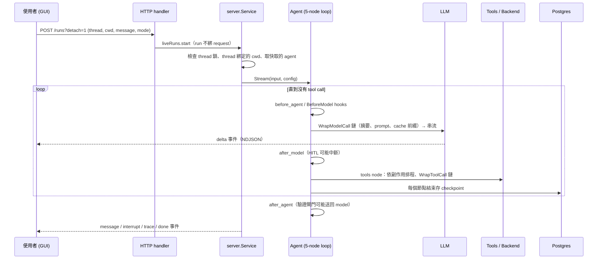

# 01 專案概覽與整體架構

## 1. 專案定位

| 部分 | 內容 |
|---|---|
| 核心 SDK（根套件 `quill`） | `CreateAgent`、middleware、backend、profiles、checkpoint |
| quill | coding agent 產品：CLI、TUI、GUI、server、coding 工具、驗證閘門 |
| quillbench | SWE-bench Pro V2 評測、報表、統計、離線 trace 分析 |

技術選型：

- **圖執行與 checkpoint**：[langgraphgo](https://github.com/smallnest/langgraphgo)（Go 沒有官方 LangGraph）。
- **OpenAI Chat Completions**：[langchaingo](https://github.com/tmc/langchaingo)。
- middleware、backend、profiles、CLI 全部自建。
- **為什麼用 Go**：工具平行執行、subagent 平行、串流都需要大量並行；單一 binary 可以把 React GUI `embed` 進去；`context.Context` 讓取消可以一路傳到 shell 子程序。

## 2. 分層與依賴方向

```
cmd/quill, cmd/quillbench          入口
code/*                         quill 產品層（agent 組裝、server、gui、tui、codetools、bench ...）
quill（根套件）                 CreateAgent：組裝預設 middleware、subagents、profiles
middleware/*                   filesystem、subagents、summarization、hitl、memory、skills、planmode ...
backend                        檔案 / shell 後端（state、store、filesystem、local shell、docker exec、composite ...）
profiles                       Harness / Provider profiles（依模型調整 prompt、工具描述、排除 middleware）
agent                          Middleware 介面與 5-node 迴圈（建在 langgraphgo MessageGraph 上）
llm, tool                      訊息、ChatModel、Tool 介面
runtime                        State、Checkpointer、Store、Interrupt
internal/notimpl               未實作 sentinel error
```

規則：**依賴只能由上往下**，下層不可 import 上層。未實作的函式一律回傳 `notimpl.Err("pkg.Func")`，用 `errors.Is(err, notimpl.ErrNotImplemented)` 判斷，讓尚未完成的部分可以逐項追蹤。

## 3. 五個核心介面

整個系統的可替換性來自這幾個小介面：

| 介面 | 位置 | 職責 | 實作 |
|---|---|---|---|
| `llm.ChatModel` | [llm/model.go](../../apps/agent/llm/model.go) | `Generate` / `Stream` / `Info` / `Profile` | OpenAI、OpenRouter、FakeModel（測試用）、動態切換 wrapper、計費 wrapper |
| `tool.Tool` | [tool/tool.go](../../apps/agent/tool/tool.go) | `Name` / `Description` / `Schema` / `Invoke`；可選 `Effector` 宣告副作用 | 檔案工具、codetools、web 工具、`task` ... |
| `backend.Backend` | [backend/protocol.go](../../apps/agent/backend/protocol.go) | `Ls/Read/Write/Edit/Grep/Glob/Upload/Download`；可選 `SandboxBackend`（`Execute`）、`Deleter` | StateBackend、FilesystemBackend、LocalShellBackend、DockerExecBackend、CompositeBackend、StoreBackend、VersionGuard |
| `runtime.Checkpointer` | [runtime/checkpoint.go](../../apps/agent/runtime/checkpoint.go) | `Put/Latest/List/DeleteThread` | Memory、Postgres |
| `agent.Middleware` | [agent/middleware.go](../../apps/agent/agent/middleware.go) | 只要求 `Name()`，其他 hook 都是可選介面 | 約 20 個 middleware |

**能力用「可選介面」表達**：例如 backend 有沒有 `Execute`，決定 agent 有沒有 `execute` 工具；backend 有沒有 `Delete`，決定有沒有 `delete` 工具。包一層 wrapper（例如 VersionGuard）時，要把原本的可選能力保留下來，所以 [backend/versionguard.go](../../apps/agent/backend/versionguard.go) 會依原 backend 有哪些能力，組出對應的匿名 struct。

## 4. Middleware：Python `AgentMiddleware` 的 Go 版

Python 是一個基底類別、子類別覆寫方法；Go 改成「實作哪個介面就有哪個 hook」，迴圈用 type assertion 發現 hook：

| Hook | 時機 | 執行順序 | 典型用途 |
|---|---|---|---|
| `BeforeAgent` | 每次 invoke 開始一次 | 正序 | 補上懸空的 tool call、重讀 AGENTS.md |
| `BeforeModel` | 每次呼叫模型前 | 正序 | 注入背景任務通知 |
| `WrapModelCall` | 包住模型呼叫 | 越前面越外層 | 摘要、注入 system prompt、過濾工具、加尾端提醒 |
| `AfterModel` | 模型回覆後 | **逆序** | 人工核准（HITL） |
| `WrapToolCall` | 包住每個工具呼叫 | 越前面越外層 | 權限檢查、重複失敗拒絕、服務啟動提示、危險指令攔截 |
| `AfterAgent` | 迴圈要結束時 | 逆序；可回傳 `Goto: "model"` 重新進入迴圈 | 驗證閘門、等待背景任務 |
| `ToolProvider` / `StateSchemaProvider` | 組裝時 | — | 提供工具、宣告 state key（含 private key 與 reducer） |

## 5. 組裝：`CreateAgent` 與 `CreateCLIAgent`

### 5.1 核心 SDK 的預設 stack（[assembly.go](../../apps/agent/assembly.go)）

```
Skills → Filesystem → SubAgent → Summarization → PatchToolCalls → AsyncSubAgent
       → [呼叫端的 middleware] → profile 額外的 → Memory → HITL → ToolExclusion
```

- 呼叫端傳入的 middleware **同名就原地取代**，不同名則插在核心 stack 之後。
- **Summarization 一律移到最後**（`placeSummarizationLast`）：它要量「完整組好的請求」有多少 token，包括 memory、skills、其他 middleware 加的 prompt 與過濾後的工具。
- Harness profile 可以排除某些 middleware，但不能排除必要的；排除了不存在的名字也會報錯（設定錯誤要早點炸）。
- 預設會多一個 `general-purpose` subagent，繼承主 agent 的工具。
- private state key（例如摘要事件）會告訴 subagent middleware，不傳給 subagent。

### 5.2 quill 的組裝（[code/agent/agent.go](../../apps/agent/code/agent/agent.go)）

**Backend 由內到外包四層：**

```
LocalShellBackend（cwd 當 "/"，virtual mode）
  → withHostRoutes：CompositeBackend，把 /.quill/... 路由到 skills（唯讀）、artifacts（Redis / Postgres）
  → trace.WrapBackend：寫入 / 編輯 / 刪除時記錄完整 unified diff
  → VersionGuard：沒讀過或讀後被改過的檔案不准改
```

**Middleware（依情境開關）：**

| Middleware | 何時掛 | 作用 | 文件 |
|---|---|---|---|
| BudgetNotice | headless | 用掉 80% 時間或步數後提醒收斂 | 07 |
| ProgressMonitor | 預設 | 同樣失敗的呼叫第 3 次拒絕 | 07 |
| Summarization | 預設 | 長對話摘要、offload | 05 |
| TodoList | 預設 | `write_todos` | 11 |
| Memory | 預設 | AGENTS.md，每個 turn 重讀 | 05 |
| LiveContext | 預設 | git status 放請求尾端，保護 cache 前綴 | 05 |
| Skills | 有 skill 時 | SKILL.md 列表 | — |
| VerifyGate | headless | 驗證閘門、HEAD baseline、test edits、diff review | 06 |
| DestructiveGuard | headless 且自動核准 | 直接拒絕破壞性指令 | 08 |
| PlanMode + AskUser | interactive | Plan 模式、選擇題提問 | 11 |
| HITL | 非 YOLO 或破壞性指令 | 人工核准 | 08 |
| trace.Middleware | 預設 | subagent 的 trace 帶 namespace | 12 |

**工具**：web 工具（有 key 才掛）＋ codetools（`git_status`、`git_diff`、`apply_patch`、`run_tests`、`diagnostics`）＋ filesystem middleware 提供的 `ls/read_file/write_file/edit_file/delete/glob/grep/execute`。

**Subagents**：`explorer`（唯讀）、`web-researcher`（有 web key 才有）、使用者在 AGENTS.md 定義的自訂 subagent、預設的 `general-purpose`。

**headless 與 interactive 的差異**是刻意設計的：headless（`-n`、quillbench）沒有人可以問、沒有人在看，所以加驗證閘門、預算提醒、破壞性指令直接拒絕；interactive 有人在場，改成核准框與 Plan 模式。system prompt 也依模式替換 6 個段落（例如 headless 明確說「不要問澄清問題」）。

## 6. 一個請求怎麼流過系統



- **NDJSON 事件**：`delta`（token）、`message`、`interrupt`（等核准）、`trace`、`done`、`error`。
- **GUI 重新整理不會中斷 run**：run 的事件緩存在 server，`GET /threads/{id}/events` 從頭重播再持續跟隨（見 09）。
- **一個 thread 同時只能有一個 run**，thread 綁定建立它的目錄，換目錄使用會被拒絕。
- 沒設定 `QUILL_SERVER` 時，同一套 server 在 `quill` 行程內跑（in-process），程式路徑一致。

## 7. 儲存

| 存放處 | 內容 | 原因 |
|---|---|---|
| Postgres | checkpoint（每 thread 保留最新 10 筆）、thread 列表、待核准的 tool call、plan、trace（record + 以 hash 去重的 blob）、摘要前的完整對話 | 重啟後一定要讀回 |
| Redis（有 TTL） | 網頁原文（24h）、搜尋 / 擷取 / Context7 結果、被移出 context 的大型 tool 輸出（預設 7 天） | 可以重新產生；過期時提示重跑工具 |
| quillbench Postgres | `bench_tasks`、`bench_runs`、`bench_attempts`（含 process JSONB）、多個統計 view | 跨 run 比較 |

啟動時 Postgres 或 Redis 任一個連不上就直接失敗（fail fast），而不是悄悄退回記憶體模式造成「重啟後資料不見」。

## 8. 面試講法

> 「系統分三層：一個可組裝的 Go agent SDK、上面的 coding agent 產品 quill、以及評測框架 quillbench。SDK 的核心是 5 個節點的 model→tool 迴圈，所有功能都是 middleware，用 Go 的可選介面表達 hook。quill 在 SDK 上加了 coding 工具、驗證閘門、安全機制，並把 backend 包成四層：本機 shell、路由、trace、版本守衛。headless 與 interactive 兩種模式掛不同的 middleware，因為『有沒有人在場』決定了安全與驗證策略。」

可能的追問：

- **為什麼 middleware 用可選介面而不是一個大介面？** 大部分 middleware 只用 1–2 個 hook；可選介面讓實作只寫需要的方法，也讓迴圈只對實作了的 middleware 呼叫。
- **為什麼摘要放最後？** 它要量最終請求大小；放前面會漏算後面 middleware 加進去的 prompt 與工具定義。
- **為什麼 VersionGuard 包在最外層？** subagent、`apply_patch`、一般編輯都經過同一個 guard，才不會有某條路徑繞過「先讀再改」。
