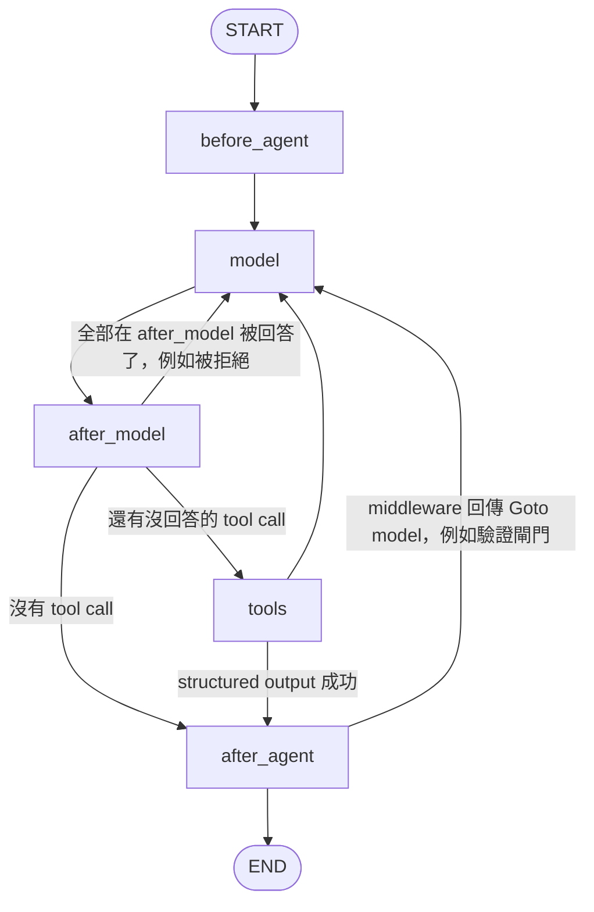

# 02 Agent 主迴圈

## 問題

Coding agent 的核心要長什麼樣？要不要做 Planner / Executor / Reviewer 多個 agent？要不要先分類任務再路由到不同流程？人工核准、串流、crash、structured output 要怎麼塞進迴圈而不讓它變複雜？

## 業界怎麼做

- **Codex**：「模型推論 → 執行工具 → 輸出附加到輸入 → 重複」，每次請求都是上一次的前綴延伸，以利 prompt cache。
- **mini-SWE-agent**：約 100 行的 loop，有步數、成本、時間上限，SWE-bench 拿它當 bash-only 對照組。
- **Anthropic《Building effective agents》**：先用最簡單可行的方案，必要時才加 workflow 或多 agent。
- 主流 coding agent 的差異主要在**工具介面、context 管理、驗證**，不在迴圈本身。

## 我的決定

**保留單一 model → tool 迴圈，不加 Planner / Orchestrator / Reviewer，也不做 model router。** 新能力全部做成 middleware 或節點之間的路由判斷。理由在 [14_design_decisions_and_lessons.md](14_design_decisions_and_lessons.md)：benchmark 的失敗都和「需求理解」「規劃」無關。

## 5 個節點的圖

實作：[agent/loop.go](../../agent/loop.go)，建在 langgraphgo 的 `MessageGraph` 上（這一版的 `StateGraph.Compile` 不支援 `InterruptBefore`，所以選 MessageGraph）。



| 節點 | 做什麼 |
|---|---|
| `before_agent` | 每次 invoke 跑一次 `BeforeAgent` hooks（補懸空 tool call、重讀記憶） |
| `model` | 檢查步數上限 → `BeforeModel` hooks → 組 `ModelRequest` → 走 `WrapModelCall` 鏈 → 呼叫模型 → 把回覆寫進 state |
| `after_model` | **逆序**跑 `AfterModel` hooks（HITL 在這裡中斷） |
| `tools` | 平行執行這一回合的 tool calls（依副作用排程，見 03），依呼叫順序套用結果 |
| `after_agent` | 逆序跑 `AfterAgent` hooks；任何一個回傳 `Goto: "model"` 就重新進入迴圈 |

### 為什麼 `after_model` 要獨立成一個節點

HITL 核准在模型回覆之後發生。如果把它放在 `model` 節點裡，中斷後 resume 會**從節點開頭重跑，等於再呼叫一次模型**：多花錢，而且模型這次可能提出不同的 tool call，使用者核准的東西就對不上了。獨立成節點後，checkpoint 存在 `model` 之後，resume 只重跑 `after_model`。

### Interrupt / Resume 的機制

```go
func Interrupt(ctx context.Context, value any) (any, error) {
	if slot, ok := ctx.Value(resumeSlotKey{}).(*resumeSlot); ok {
		if v, ok := slot.take(); ok {
			return v, nil
		}
	}
	return nil, &graph.NodeInterrupt{Value: value}
}
```

- 第一次呼叫：丟出 `NodeInterrupt`，迴圈把 state、`PendingInterrupts`、`ResumeFrom`（下一個要跑的節點）存進 checkpoint，回傳 `InterruptError` 給呼叫端。
- 使用者回覆後用 `Resume` 再 invoke：從 checkpoint 讀回 state，把 resume 值放進 ctx 的 `resumeSlot`，從 `ResumeFrom` 繼續。hook 重跑時 `Interrupt` 直接回傳 resume 值。
- **resume 值只能用一次**（`slot.used`），所以同一個 run 裡後面的 `Interrupt` 會再次暫停，不會誤用上一次的答案。
- 因為狀態都在 Postgres checkpoint 裡，**server 重啟後待核准的 tool call 還在**。

## 迴圈的防護

| 情況 | 處理 | 為什麼 |
|---|---|---|
| 步數超過上限 | `ErrRecursionLimit` | 對應 LangGraph `GraphRecursionError`，避免無限迴圈燒錢 |
| 節點 panic | `guardNode` recover，轉成 `ErrPanic`（附 16 行 stack） | langgraphgo 在獨立 goroutine 跑節點，沒 recover 會讓整個 server 掛掉 |
| 工具 panic | 轉成 error tool message | 模型可以看到錯誤並換做法，run 不會中止 |
| 模型呼叫不存在的工具 | 回 `Error: X is not a valid tool, try one of [...]` | 讓模型自我修正 |
| 工具回傳 error | 包成 `Error: ...` 的 tool message | 同上 |
| ctx 被取消 | 取消錯誤往上傳，**不**包成 tool message | 使用者按 Stop 時要真的停 |
| 多個 middleware 同名、工具同名 | 組裝時報錯 | 設定錯誤早點發現 |

## 怎麼判斷「還有沒回答的 tool call」

`pendingToolCalls` 從最後一則 assistant 訊息往後找，扣掉已經有 tool message 回答的 call ID。這個判斷完全從訊息推導，所以：

- HITL 拒絕某個 call 時，`after_model` 直接補一則 error tool message，那個 call 就不會進 `tools` 節點。
- 如果全部 call 都在 `after_model` 被回答了（例如全部被拒絕），路由回 `model`，讓模型看到拒絕理由。

## 串流

- `Stream` 時把 emitter 放進 ctx（`chunkEmitKey`），`callModel` 看到就走 `streamModel`，每個 chunk 發一個 `StreamMessages` 事件；模型不支援串流就退回 `Generate`。
- **巢狀 run 不能把 token 串進父 run**：`Invoke`（subagent 用的）會把 ctx 裡的 emitter 清掉。subagent 的事件改由 `task` 工具以 `task:<tool call id>` namespace 轉發，GUI 才能把它縮排在對應的 task 底下。
- 平行的工具（例如兩個 subagent）會同時 emit，而 Go 的 `iter.Seq2` 的 `yield` 不能並行呼叫，所以 emit 外面有一把 mutex；client 不讀了（`yield` 回 false）就取消整個 run。

## Structured output（ToolStrategy）

實作：[agent/structured.go](../../agent/structured.go)。

- 有 `ResponseFormat` 時，在**最內層**模型呼叫加一個合成工具（名稱取 schema 的 `title`），所以 middleware 過濾工具時不會把它拿掉。
- 模型呼叫它且通過 schema 驗證（type / enum / required / additionalProperties / items）→ 寫進 `structured_response`，直接跳到 `after_agent` 結束。
- 不合 schema → 回錯誤讓模型重試；同一回合呼叫多次 → 全部拒絕，要求只呼叫一次。
- `ProviderStrategy`（provider 原生 JSON mode）回 `ErrNotImplemented`，明確標示沒做。

## 訊息 ID

所有沒有 ID 的輸入訊息與模型回覆都補上隨機 ID（對應 LangGraph `ensure_message_ids`）。之後 HITL 的 edit 決策要「依 ID 取代」那則 assistant 訊息裡的 tool call 參數；`PatchToolCalls` 也用 `RemoveAllMessages` + 重寫整串的方式修補歷史。

## 測試方式

`llm.FakeModel` 依序回傳預先寫好的訊息，所以迴圈的每條路徑都能 deterministic 地測：無 tool call、多輪 tool call、未知工具、工具錯誤、步數上限、hook 順序、HITL approve / reject / edit、resume 值不重用、structured output 重試、串流事件順序、panic 防護。

## 面試講法

> 「我刻意只用一個 model→tool 迴圈，5 個節點。最值得講的是把 `after_model` 拆成獨立節點：人工核准會中斷 run，如果核准邏輯和模型呼叫在同一個節點，resume 時會重新呼叫模型，不但多花錢，模型還可能提出不同的 tool call，使用者核准的東西就失效了。拆開後 checkpoint 存在模型呼叫之後，resume 只重跑核准那一步。」

可能的追問：

- **為什麼不做 multi-agent？** 見 10：多 agent 約 15 倍 token，平行寫同一份產出會互相矛盾；有效的是唯讀研究型 subagent，我有做。
- **AfterAgent 回到 model 會不會無限迴圈？** 驗證閘門最多擋 2 次，另外有步數上限兜底；擋的次數從對話裡的標記數出來，checkpoint 還原後一樣有效。
- **工具錯誤為什麼不直接中止 run？** 大部分工具錯誤是模型參數錯，回給模型就能修正。工具本身的錯誤與 panic 都轉成 error tool message；只有 ctx 取消、以及 middleware 自己回傳的錯誤會中止 run。
