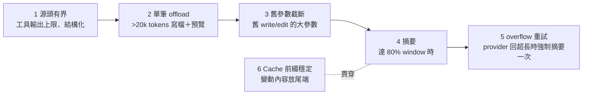

# 05 Context 管理

## 問題

Coding agent 的 context 只會增加：每讀一個檔、每跑一次測試都留在對話裡。

- **成本**：每次請求都重送整段歷史。歷史 baseline 中，早期 20 個 attempt 平均每題 1.77M input tokens，後期 8 個平均 10.74M，最高單次 context 577k。
- **超過上限**：provider 直接回 400。
- **Prompt cache 失效**：provider 的 cache 以「完全相同的前綴」為單位，前面任何一個位元組變了，後面全部要重新計費。
- **壓縮又會丟資訊**：摘要掉了細節，agent 只好重讀。

## 業界怎麼做

| 來源 | 做法 |
|---|---|
| Codex | 每次請求都是前一次的完全前綴延伸；換工具、模型、cwd 都會讓 cache 失效 |
| JetBrains《The Complexity Trap》 | observation masking（把舊的工具輸出換成 placeholder）在 SWE-bench Verified 上成本減半，解題率與 LLM 摘要相當 |
| Anthropic context editing | 清除舊的 tool result，保留 tool_use |
| OpenHands condenser | 保留前 N 個與最近的事件，中間交給 LLM 摘要；condensation 本身也是事件 |
| Cursor | 長輸出寫成檔案；摘要後提供完整歷史的引用 |

## 我的做法：分層處理



第 1、2 層見 [04_tool_interface_design.md](04_tool_interface_design.md)。以下講 3–6。

---

## 1. Summarization middleware

實作：[middleware/summarization/summarization.go](../../apps/agent/middleware/summarization/summarization.go)、[cutoff.go](../../apps/agent/middleware/summarization/cutoff.go)。

### 觸發條件依模型決定（`ComputeDefaults`）

| 模型 | 觸發 | 保留 |
|---|---|---|
| 已知 context window（profile 表裡有） | 用到 window 的 80% | 最近 10% |
| 未知 | 170k tokens（假設 window 200k 的 85%） | 最近 6 則訊息 |

`DynamicDefaults` 讓執行中切換模型（`/model`）時，門檻依新模型重算。

### 不改寫歷史，只記事件

```go
// Event records a completed summarization (stored under EventStateKey).
type Event struct {
	CutoffIndex    int         `json:"cutoff_index"`
	SummaryMessage llm.Message `json:"summary_message"`
	FilePath       string      `json:"file_path,omitempty"`
}
```

- state 裡的訊息**永遠不改**。摘要只在 state 存一個 private 的 `Event`（切點 + 摘要訊息 + offload 路徑）。
- 每次呼叫模型時，`applyEvent` 組出「摘要 + 切點之後的訊息」送出去。
- 好處：完整歷史還在 checkpoint 裡，GUI 可以完整顯示；摘要可以再摘要（新切點以舊事件為基準換算）；fork subagent 可以拿到壓縮後的版本。

### 切點不能拆散 tool call 配對

provider 要求每個 tool call 後面一定有對應的 tool result。`cutoffIndex` 會調整切點，確保不會把 assistant 的 tool call 留在摘要裡、結果卻留在保留區（或反過來）。

### Offload 完整歷史

被摘要掉的訊息先寫到 `/conversation_history/<session>.md`（quill 存 Postgres），摘要訊息裡附上路徑。agent 需要細節時可以 `read_file`。**先 offload 再摘要**，所以摘要失敗也不會丟資料。

### 摘要本身的容錯

| 情況 | 處理 | 來由 |
|---|---|---|
| 歷史太長，一次塞不進摘要請求 | 分塊摘要，每塊上限 window / 4 | Stage 15d：原本封頂 16k，36k tokens 的歷史要摘 10 次 |
| 摘要模型回錯誤（例如 empty response） | 記 log，改用「摘要不可用，完整歷史已存到 <path>」繼續 | Stage 16b：b398、8168 曾因摘要回 empty response 整個 attempt 中止 |
| 取消、逾時、overflow | 照樣回傳錯誤 | 這些是真的要停 |
| system prompt + 工具定義已經超過預算 | 直接回 `ErrContextOverflow` 並說明 | 沒有任何對話能塞得進去，摘要也沒用 |

### Overflow 自動重試

provider 回 `context_length_exceeded` / `maximum context length` 時，[llm/openai.go](../../apps/agent/llm/openai.go) 把它包成 `llm.ErrContextOverflow`。摘要 middleware 看到就**強制摘要一次再重送**；壓縮後還是太長才真的報錯。這保護了 token 估算不準的情況（估算用的是近似計數器）。

### 舊參數截斷

摘要前的較便宜一步：把較舊的 `write_file` / `edit_file` 呼叫中超過 2000 字元的參數換成 `...(argument truncated)`。這些內容已經寫進檔案，留在歷史裡只是重複。

### 為什麼放在 stack 最後

它要量「最終送出的請求」：system prompt（含 memory、skills、其他 middleware 追加的段落）+ 歷史 + 工具定義。放前面會低估。

### 手動壓縮

`/compact` 指令與 `compact_conversation` 工具，不論門檻立刻摘要。

### 踩過的坑：16k 門檻

驗證 Stage 12 時發現，一份未提交的修改把「未知模型」的觸發門檻從 170k 降到 16k，而當時用的模型不在 profile 表內。結果**每幾步就摘要一次**，agent 反覆重讀檔案而不動手：一個 attempt 343 次 tool call、零修改。修法是讓 `contextBudget` 與分塊上限都從同一個「假設 200k window」推算，並把模型加進 profile 表。教訓：context 管理過度積極，比不做更糟。

---

## 2. Prompt cache 前綴穩定（R4）

### 問題

`liveContext` 原本每次呼叫都把 `git status` 附在 **system message 尾端**。每次編輯後 git status 都變，system message 變了，provider 的 cache 從第一個 token 就斷掉。R1 觀察到長 NodeBB run 有 1–8 次無法由新訊息解釋的 >10k input token 跳升。

### 做法

實作：[code/agent/context_middleware.go](../../apps/agent/code/agent/context_middleware.go)。

- **固定的內容**（模型身分、quillbench 的固定 project context）留在 system message。
- **會變的內容**（git status）改成只存在於該次請求的**尾端 system 訊息**，帶 `lc_source: live_context` metadata：
  - 不寫進 state（下一次請求不會帶舊的那份）；
  - 不算 user turn（history 分頁、驗證閘門判斷 turn 起點時都會略過）。
  - 必須是 system 角色，不能是 user（RL8 量到的）：OpenAI 把 cache 寫在「最後一則 user 訊息」的結尾，尾端 user 訊息每次換掉，下一次就沒有可沿用的前綴；它還會讓前面的工具呼叫歷史重新渲染，每次多約 17k input tokens。改成 system 後 cache 命中由約 35% 回到約 87%。
- 同樣的模式（`requestTail`）也用在預算提醒（`lc_source: budget`，見 07）與 `<repair-state>`（`lc_source: repair_state`）。
- **Memory 重讀也顧 cache**（R8）：`AGENTS.md` 改成每個 invocation 開始時重讀（原本一個 thread 只讀一次，agent 或使用者後來寫進去的內容整個 thread 都看不到），但**只有內容不同才更新 state**，沒改時 system message 位元組完全相同。
- 測試 `TestSystemMessageIsStableWithinARun`：經過 `write_todos` 與 `write_file` 後，system message 仍然位元組相同，尾端看得到新檔。

### 推理內容回傳（評估後不做）

OpenAI 與 OpenRouter 文件都要求在 tool call 之間把 reasoning items / `reasoning_details` 原樣傳回，否則 cache 利用率會下降。R4 先花約 $0.001 送 3 個 probe 請求：我們用的模型經 OpenRouter Chat Completions **完全不回傳推理內容**（三種設定都試過）。沒有東西可以傳回，所以不做 passthrough，也確認了 token 跳升不是這個原因。**先 probe 再實作**，省下一個沒有效果的改動。

---

## 3. Observation masking：做了又刪掉的實驗（R6）

這是最值得在面試講的一段，因為它展示了「離線估計」與「真實行為」的落差。

### 做法

把較舊的 `read_file`、`grep`、`glob`、`ls`、`git_diff`、`git_status` 結果換成 placeholder；保留最近 10 個、錯誤、短結果、所有 shell / 測試 / 編輯輸出。

- **cache 是設計關鍵**：遮蔽會改寫舊訊息，cache 從那裡斷掉。所以每累積 20 個才一起遮蔽一次（batch）。
- **錯誤全部保留**：如果只保留最近 3 個錯誤，每來一個新錯誤就遮掉一個舊的，cache 前綴不斷斷掉。

### 離線重播（看起來很好）

用 4 個歷史 run 的 trace，對每個請求計算遮蔽前後的 token 與 prefix cache，掃描 keep × batch 參數：

- input tokens 44.2M → 21.1M（**−52%**）；輸入成本 −15% 到 −42%。

### 真實評測（結果相反）

| | baseline | 含 masking |
|---|---|---|
| 步數 | 37 | 60（**+60%**） |
| 時間 | 15.2 分 | 19.1 分 |
| input tokens | 5.25M | 4.49M（只 −15%，7 題中 6 題反而上升） |

原因：agent **重讀被遮蔽的檔案**。678 次 `read_file` 中 234 次是重讀「上一次結果已被遮蔽」的檔案，重讀同路徑比例 41% → 75%；`apply_patch` 失敗由每個 attempt 2.5 次升到 5.4 次（依記憶寫 patch，失敗再重讀）。

### 處理與教訓

- 兩項 Success Criteria 都沒達到 → **整個刪掉**（含開關與離線重播）。R10 重跑：三題步數都回到或低於 baseline，`read_file` 次數約為含 masking 時的 1/4–1/3。
- **離線重播沒有模擬「agent 會因此改變行為」**，這是誤判的根源。
- 如果要重做：不遮蔽之後還會編輯的檔案，或只遮蔽 grep / glob / ls。

## 面試講法

> 「context 我分層處理：工具輸出在源頭就有上限；單筆超過 20k tokens 就寫檔只回預覽；整段對話到 80% window 才摘要。摘要不改寫歷史，只在 state 記一個切點事件，切點保證不拆散 tool call 和結果的配對，被摘掉的部分先 offload 再摘要，所以摘要模型失敗也能繼續。另一個重點是 prompt cache：我把每次都會變的 git status 從 system message 移到請求尾端、而且不寫進 state，讓整個 run 的前綴位元組相同。」
>
> 「我也做過一個失敗的實驗：observation masking。離線重播估計省 52% token，實測步數多 60%，因為 agent 會重讀被遮蔽的檔案。我把它整個刪掉，學到離線評估必須考慮 agent 的行為回饋。」

可能的追問：

- **為什麼不直接用 LLM 摘要取代一切？** 摘要會丟細節、有額外成本與延遲；能用確定性方法（截斷、offload）解決的先用。
- **token 怎麼算？** 近似計數器（約 4 字元 1 token）；不準的部分由 overflow 重試兜底。
- **怎麼證明 cache 前綴穩定？** 測試比對多次請求的 system message 位元組；quillbench 記錄每題 cache 命中率（baseline 73–96%）。
