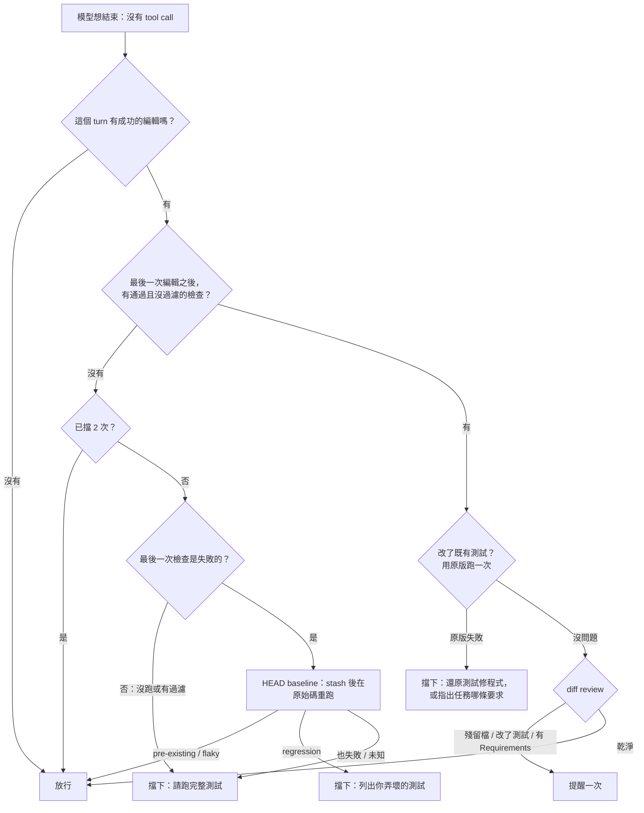

# 06 驗證與完成閘門

> 這是整個專案最核心、也最適合面試深入講的一章：問題從 benchmark 資料中被發現，解法是確定性的程式，每一步都有量測。

## 問題

Agent 最常見的失敗不是「不會寫」，而是「**不知道自己沒做完或做壞了**」：

1. **沒驗證就宣告完成**。Stage 12 的 NodeBB 題：Redis 沒啟動，一次測試都沒跑成功，只跑了 lint 就說完成；兩個 bug 跑測試就會現形。system prompt 早就寫了「Verify before declaring done」，**只靠 prompt 不夠**。
2. **只跑過濾後的測試**。bd80：用 `run_tests run="blocking access for unconfirmed emails"` 只跑 2 個測試就結束，同檔另外三個測試被改壞。
3. **把自己造成的 regression 說成「無關」**。bd80：完整跑了 `test/controllers.js`，看到 export 測試失敗，判定是「與改動無關的環境問題」就結束。那個測試在原始程式碼上會過。
4. **改測試來配合自己的實作**。b398：把 `should fail to add self to room` 的期望從 400 改成 403。
5. **留下副產品**。`redis-server --daemonize yes` 在工作目錄留下 `dump.rdb`，被收進 patch。

### 資料

歷史 baseline（SWE-bench Pro 前 10 題，4 個 run、28 個 attempt）：**7 個失敗中 F2P（要修好的測試）全部通過**，6 個是 P2P regression（1–12 個原本會過的測試被改壞），1 個逾時。R1 的失敗分類：`regression_unnoticed` 4 次、`regression_dismissed` 1 次。

## 業界依據

- **Huang et al. (ICLR 2024)、Kamoi et al. (TACL 2024)**：沒有外部回饋的自我修正通常無效；有可靠外部回饋（測試、編譯器）才有效。
- **Agentless**：用既有 regression test（只保留在原始碼上會通過的）篩選 patch。
- **Claude Code `Stop` hook**：可以在 agent 想結束時擋下。
- **SWE-agent**：編輯時跑 linter 擋語法錯誤。

## 設計原則

- **確定性問題交給程式**：「改了檔案之後有沒有跑過完整測試」「這個失敗在原始碼上會不會發生」都可以用程式判斷，不需要問 LLM。
- **只在 headless 掛**：interactive 模式使用者在場，而且 HEAD baseline 會 `git stash` 整個工作樹，使用者同時在編輯會衝突。
- **有上限**：最多擋 2 次，最後一次明說「如果還是沒辦法，在最終回覆說明哪些沒驗證」，不會無限循環。
- **狀態從 transcript 推導**：每則閘門訊息以 `[verify]` 開頭並帶 metadata，擋了幾次、做過哪種檢查都從對話數出來，checkpoint 還原後一樣正確。

## 整體流程

實作：[code/agent/verify.go](../../code/agent/verify.go)（`AfterAgent` hook）。

每種檢查**每個 turn 最多做一次**；test edits 與 diff review 不佔原本 2 次的擋下額度。

---

## 1. 判斷「有沒有驗證」（Stage 12 / 16）

`inspectTurn` 從這個 turn 的起點（最後一則不是閘門寫的 user 訊息）往後掃：

- **最後一次成功編輯**：`write_file`、`edit_file`、`apply_patch` 成功的結果。編輯會清掉之前的檢查結果。
- **之後最後一次檢查**（`classifyCheck`）：
  - `run_tests`：解析 JSON，`status == passed` 才算通過；`no_tests` 或 0 個通過算「沒跑任何測試」（npm fallback 沒有計數，例外處理）。
  - `execute`：指令符合測試 / build 的 regex（`go test`、`npm test`、`npx jest`、`pytest`、`python -m unittest`、`make test`、`cargo test`、`tox` ...），再讀結尾的 exit code；exit 0 但輸出是 `0 passing`、`collected 0 items` 也算沒跑。
- **測試名稱過濾不算驗證**（Stage 16a）：`run_tests run=...`、mocha `--grep/-g/--fgrep`、jest/vitest `-t`、`go test -run`、pytest `-k` 或 `file.py::test` 都會被偵測。通過了也要求「不帶過濾把同一批測試檔再跑一次」。`-timeout`、`-tags` 這類旗標不會誤判。

擋下的訊息依情況不同：沒跑 → 列出改過的檔案；有過濾 → 說明同檔其他測試可能壞掉；失敗 → 列出前 5 個失敗（file:line + 訊息）與 build 錯誤。都會加一句「如果是環境問題（缺服務、依賴、資料庫），把環境建起來，不要放棄」。

## 2. 服務啟動提示

同一個 middleware 的 `WrapToolCall`：`execute` / `run_tests` 輸出有 `ECONNREFUSED` 時，從輸出抓出 port，對常見服務附上啟動指令：

| port | 服務 | 指令 |
|---|---|---|
| 6379 | Redis | `redis-server --daemonize yes --save '' --dir /tmp` |
| 27017 | MongoDB | `mongod --fork --dbpath /tmp/mongo ...` |
| 5432 | PostgreSQL | `service postgresql start` |
| 3306 | MySQL | `service mysql start` |

Redis 的 `--save '' --dir /tmp` 是踩坑後加的：原本的指令在 `/app` 留下 `dump.rdb`，被收進 patch。最終評測中每個 NodeBB attempt 觸發 1 次。

## 3. HEAD baseline：這個失敗是我造成的嗎？（R5）

實作：[code/agent/baseline.go](../../code/agent/baseline.go)。

**流程**：

1. 記下目前 `refs/stash`，`git stash push --include-untracked`（含未追蹤檔）。
2. 確認真的 stash 到東西，另存一份到 `refs/quill/baseline`（萬一還原失敗，修改仍然找得回來）。
3. 在原始 HEAD 上重跑**同一個**檢查（`run_tests` 用同樣參數重新 invoke；`execute` 重跑同一條指令、同樣 timeout）。
4. 還原：`git reset --hard` + `git clean -fd`（清掉 HEAD 上跑測試的副產品）+ `git stash pop`，成功後刪掉 ref。
5. 還原失敗時**不會遺失修改**：錯誤訊息告訴 agent 用 `git stash apply <sha>` 取回。還原用 `context.WithoutCancel`，run 被取消也要把工作樹恢復。

**判定**：

| HEAD 上的結果 | 再跑一次（含修改） | 判定 | 閘門行為 |
|---|---|---|---|
| 同名測試也失敗 | — | `preexisting` | 放行 |
| 通過 | 通過 | `flaky` | 放行 |
| 通過 | 仍失敗（同名測試） | `regression` | 擋下，列出「Broken by your change」 |
| 指令也失敗，不知道哪些測試 | — | `also_fails` | 照常擋，附註「HEAD 上也失敗，比對看看哪些是你造成的」 |
| 無法執行 | — | `unknown` | 照常擋 |

- 對 `run_tests`，比對的是**測試名稱集合**：修改後失敗、但 HEAD 上沒失敗的才是 regression 候選，再重跑一次確認不是 flaky。
- regression 的訊息明確寫「These are not unrelated or pre-existing failures」，直接堵住「說無關」的退路。
- 每次判定都透過 `OnBaseline` 回報（R10）：quillbench 存進 attempt 的 `process.baseline_verdicts` 與 `baseline.log`。原本放行時不留紀錄，評估時看不到它做了什麼，所以補上。

**測試**：暫存 Go repo 的四種情境（regression：未追蹤檔與修改都還原、沒有遺留 stash / ref；HEAD 也失敗；pre-existing；flaky），以及 `TestHeadlessAgentCannotDismissRegression`：用 FakeModel 重現 bd80 的劇本（改壞 → 說無關 → 想結束 → 看到 HEAD 比對 → 修好）。

## 4. Test edits：是不是改測試來配合實作？（R10）

實作：[code/agent/testedits.go](../../code/agent/testedits.go)。

- 檢查通過之後，從 `git status` 找出**被修改的既有測試檔**（新增的不算）。
- 只把這些測試檔 `git stash push -- <files>`，用**原版測試**跑在**目前的程式碼**上，再還原。
- 原版失敗 → 代表程式改變了這些測試檢查的行為，而 agent 改了測試去配合。訊息請 agent 還原測試、修程式；**如果任務真的要求改變這個行為，就保留，並在最終回覆指出是哪一條要求**。
- 這個設計刻意不直接禁止改測試，因為有些任務本來就要改行為（誤擋的代價）。
- 沿用最後一次 `run_tests` 的語言、目錄與 timeout；Go 依 package 跑，其他依檔名。

## 5. Diff review：結束前看一次工作樹（R5）

實作：[code/agent/diffreview.go](../../code/agent/diffreview.go)。

`git status --porcelain` 之後提出三件事：

- **殘留檔**：`dump.rdb`、`nohup.out`、`.log`、`.pid`、`.orig`、`.rej`、`.bak`、`.swp`、`__pycache__`、`.pytest_cache` ...
- **改到的既有測試**：提醒「只有任務改變了測試檢查的行為才改；絕不為了讓失敗的程式通過而改寫或弱化測試」。
- **任務的 `## Requirements` 清單**：從 prompt 解析條列（可跨行，最多 12 條），請 agent 逐項對照。

都沒有就不送訊息；有的話只提醒一次，結尾說「如果都沒問題，直接結束」。

---

## 量測結果

| 階段 | 結果 |
|---|---|
| Stage 12 | NodeBB 題 resolved（F2P 4/4、P2P 307/307）：agent 看到 ECONNREFUSED 後自己啟動 Redis，跑 207 / 334 個測試全過 |
| Stage 16 | bd80 trace 確認「過濾不算驗證」生效：擋下後 agent 完整跑 `test/controllers.js`，看到失敗——但仍判定無關，沒有在原始碼上確認。這直接催生了 R5 的 HEAD baseline |
| 最終評測（R0–R9） | 驗證閘門「檢查不足」觸發 6 次、diff review 11 次；bd80 1/2（baseline 1/4） |
| R10 | b398 **第一次解出**（F2P 8/8、P2P 3057/3057）：HEAD baseline 跑了一次，判定 `test/api.js` 的 OpenAPI 測試是 pre-existing 並放行，評分證實正確；bd80 18 步、$0.02 解出 |

**仍然存在的限制**（面試要主動講）：

- bd80 R0–R9 t0：評分時壞的是 `should export users uploads`，它在 agent 的環境裡是通過的——agent 根本看不到這個 regression，任何閘門都擋不了。這類失敗要靠環境一致性。
- b398 R0–R9 t1：diff review 有點名改了 `test/messaging.js`，agent 仍保留修改。這催生了 R10 的 test edits；R10 那次 agent 沒改測試，所以 test edits 還沒有被真實案例驗證過。
- 樣本小（regress 子集 7 題、R10 3 題），不宣稱統計顯著。

## 面試講法

> 「分析 benchmark 失敗時，我發現 7 個失敗全部是『要修的測試都過了，但弄壞了原本會過的測試』。所以我做了一個完成閘門：agent 想結束時，如果這個 turn 改過檔案，卻沒有在最後一次修改後跑過完整、通過的測試，就把它送回去，最多兩次。最關鍵的是 HEAD baseline：測試失敗時，閘門自動把修改 stash 起來，在原始程式碼上重跑同一個測試，再還原。原始碼上也失敗就是既有問題，放行；原始碼上通過、改完失敗、重跑還是失敗，就明確告訴 agent『這是你造成的，不是無關的』。這把『agent 自己判斷』換成了『外部回饋』，對應到自我修正的研究：沒有外部回饋的自我修正通常無效。」

可能的追問：

- **stash 會不會弄丟使用者的修改？** 只在 headless 用；stash 前另存 ref；還原失敗不刪 ref 並告訴 agent 怎麼取回；還原不受取消影響。測試涵蓋「還原後沒有遺留 stash / ref」。
- **為什麼要重跑第二次？** 區分 regression 與 flaky：HEAD 通過、修改後失敗，可能只是不穩定的測試；再跑一次仍失敗才判定 regression。
- **重跑整個測試不會很慢嗎？** 每個 turn 最多一次，只跑最後一次失敗的那個檢查，不是整個測試套件。
- **為什麼不用 LLM reviewer？** gate 與 diff review 是確定性的、針對已知失敗；reviewer subagent 的重新考慮條件是「上線後仍有語意性 regression 漏網」。
