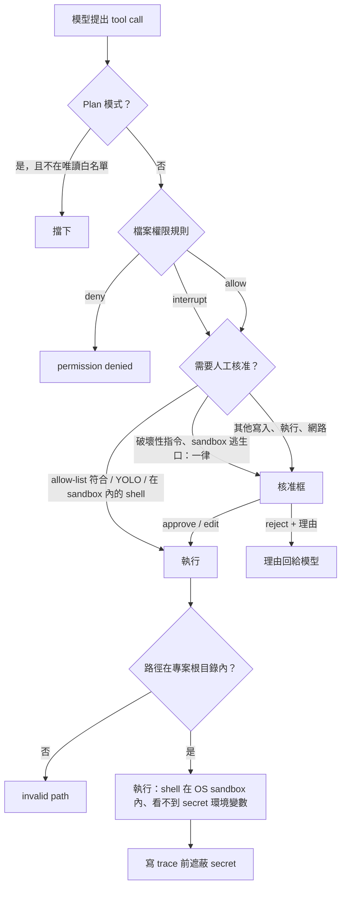

# 08 安全與權限

## 問題

Coding agent 在使用者的電腦上讀寫檔案、執行任意 shell 指令，而控制它的是一個會出錯、也可能被 prompt injection 的 LLM：

- **破壞性操作**：`rm -rf ~`、`git reset --hard` 丟掉未提交的修改、`git push --force`。
- **秘密外洩**：quill 把 `~/.quill/.env`（`OPENROUTER_API_KEY`、資料庫連線字串……）載入自己的環境，而 shell 指令繼承整個環境；`env`、`printenv` 或測試程式的錯誤輸出會把 key 帶進對話、trace，甚至送到 tracing 服務。
- **路徑逃逸**：`../../etc/passwd`、指向外部的 symlink。
- **SSRF**：`fetch_url` 被誘導去打 `169.254.169.254` 或內網服務。
- **本機 GUI 被其他網頁呼叫**：任何網站都可以對 `127.0.0.1` 發請求。
- **惡意 repo**：clone 下來的專案 `.env` 偷偷打開 tracing，把對話送出去。

## 業界怎麼做

- **Claude Code**（`@anthropic-ai/sandbox-runtime`）：macOS Seatbelt、Linux bubblewrap + 獨立 network namespace；網路走 sandbox 外的 proxy 依 domain allowlist 放行；`autoAllowBashIfSandboxed` 讓 sandbox 內的指令免核准。
- **Codex**：read-only / workspace-write / danger-full-access 三種 sandbox，搭配獨立的 approval policy；workspace-write 預設斷網。
- **Cursor**：終端機指令在 sandbox 內執行，workspace 可寫、預設斷網，被擋下時提示在 sandbox 外重跑。

## 我的立場：shell 進 OS sandbox，其他層照樣擋

shell 子程序（`execute`、`run_tests`、`diagnostics`）在 OS 層 sandbox 內執行，macOS / Linux 預設開啟（見 [§12](#12-os-層-process-sandbox)）；quill 本身不進 sandbox。sandbox 是最後一道牆，前面的多層防護都還在：

---

## 1. 路徑沙箱（virtual mode）

[backend/filesystem.go](../../apps/agent/backend/filesystem.go)：專案根目錄當作 `/`；先 `EvalSymlinks` 解析真實路徑，確認仍在根目錄內才操作。`..` 與 symlink 逃逸都有測試；刪除 symlink 只刪 link。

## 2. 人工核准（HITL）

實作：[middleware/hitl/hitl.go](../../apps/agent/middleware/hitl/hitl.go)、[code/agent/agent.go](../../apps/agent/code/agent/agent.go) 的 `DefaultInterruptOn`。

| 需要核准 | 不需要 |
|---|---|
| `write_file`、`edit_file`、`apply_patch`、`delete`、`execute`、`run_tests`、`diagnostics`、`web_search`、`fetch_url`、Context7、啟動 web-researcher 的 `task` | `ls`、`read_file`、`grep`、`glob`、`git_status`、`git_diff` |

- **sandbox 開啟時**，`execute`、`run_tests`、`diagnostics` 改成免核准，只有破壞性指令與 `sandbox: false` 逃生口要核准（§12）。
- **四種決策**：approve、edit（修改參數後執行，並取代存下的 assistant 訊息中的參數）、reject（理由回傳給模型）、respond（使用者的回答直接當工具結果，`ask_user` 用）。
- **核准框顯示 diff**：寫入 / 編輯 / patch 顯示對磁碟現有檔案的 unified diff。
- **各介面行為**：TUI `a/r/A`；`-n` 且 stdin 是終端機時逐一 `[y]es / [a]ll / [N]o / 理由`；**`-n` 但 stdin 不是終端機（管線、CI）時自動拒絕，並告訴模型沒有人可以核准**，而不是卡住等輸入。
- 設定項：`When`（只對符合的呼叫中斷）、`Always`（YOLO 下仍中斷，`ask_user` 用）、`AlwaysWhen`（符合時一律中斷，破壞性指令用）、`Describe`（每個呼叫的說明）。

## 3. Shell allow-list

實作：[code/agent/shell_allow.go](../../apps/agent/code/agent/shell_allow.go)。

- 指令以 `|`、`;`、`&&`、`||` 切段，**每段的第一個字**都在清單內才免核准。
- 含 `$(`、反引號、`$VAR`、`${`、重導向（`>`、`<`、`>>`、`<<`）、背景 `&`、換行、tab 的指令**一律要核准**。所以 `ls | grep x` 免核准，`ls "$(rm -rf /)"` 與 `ls &` 仍會問。
- `"recommended"` 展開成唯讀指令（ls、cat、grep、wc、diff ...）；`"all"` 必須單獨使用。
- `run_tests` / `diagnostics` 會依專案啟動不同 runner，清單要包含**全部可能的 runner** 才免核准（`go`、`npx`、`npm`、`node`、`python3`、`python`、`ruff`）。

## 4. 破壞性指令（R9）

實作：[code/agent/shell_risk.go](../../apps/agent/code/agent/shell_risk.go)。用固定的 regex 規則判定，**不靠 LLM**：

| 規則 | 原因 |
|---|---|
| `rm -r` 根目錄、家目錄、`.`、`*`、`..` | 遞迴刪除整個系統、家目錄或專案 |
| `git reset --hard` | 丟掉所有未提交修改 |
| `git clean -f` | 刪除未追蹤檔 |
| `git checkout -- .` / `git restore .` | 丟掉所有檔案的修改 |
| `git stash drop/clear` | 刪除 stash |
| `git push --force` / `-f` / `--force-with-lease` | 覆寫遠端歷史 |
| `curl ... \| sh` | 執行從網路下載的腳本 |
| `mkfs`、`dd of=/dev/...` | 覆寫磁碟 |
| fork bomb、`shutdown`、`reboot` | — |

- **互動模式**：`AlwaysWhen` 讓它**一律送核准**，即使用了 `-y`、allow-list 是 `"all"`、或本次已選擇自動核准；核准框寫明原因。
- **Headless 且自動核准**：沒有人能核准，`destructiveGuard` 直接回錯誤，請 agent 改用範圍較小的指令，或把確切指令告訴使用者讓他自己跑。
- **避免誤判**：`rm -rf build`、`git checkout -- src/a.go` 不會命中（table-driven 測試涵蓋）。
- **對評測的影響**：歷史 trace 的 133 個 `execute` 指令中 0 個命中，所以加上它不影響 benchmark 行為。

注意：驗證閘門自己的 HEAD baseline 會跑 `git reset --hard` 與 `git clean -fd`，但那是閘門的程式直接透過 backend 執行，不經過 agent 的工具呼叫，也有 stash + ref 保護（見 06）。

## 5. 環境變數最小化（R9）

實作：[backend/secrets.go](../../apps/agent/backend/secrets.go)、`LocalShellOptions.HideSecretEnv`。

- shell 子程序看不到名稱像 credential 的變數：`*_API_KEY`、`*_TOKEN`、`*_SECRET`、`*_PASSWORD`、`*_CONN_STRING` 等。
- 需要時以 `QUILL_SHELL_PASS_ENV=GITHUB_TOKEN,NPM_TOKEN` 放行。
- **用黑名單而不是白名單**：專案常依賴任意環境變數（`NODE_ENV`、`DATABASE_URL`、`GOPATH` ...），白名單會讓測試莫名其妙失敗。
- 測試確認 `TOKENIZERS_PARALLELISM` 這類名稱不會被誤判。

## 6. Trace 遮蔽（R9）

實作：[code/trace/redact.go](../../apps/agent/code/trace/redact.go)。

- Store 建立時記下 credential 變數的**值**（≥ 8 字元），寫入前連同常見 token 格式（`sk-...`、`ctx7sk-...`、`ghp_...`、`AKIA...`、`xox?-...`、`AIza...`）與 URL 中的密碼換成 `[REDACTED]`。
- 只替換 JSON 字串內容，紀錄仍是合法 JSON；處理 JSON 跳脫字元與跳脫換行。
- `risk-assessment-...` 這類字串不會被誤遮。

這三項（破壞性指令、環境、trace）是安全底線，**沒有 ablation 開關**。

## 7. 檔案權限規則（SDK 功能）

實作：[middleware/permissions/permissions.go](../../apps/agent/middleware/permissions/permissions.go)。

- 規則：`{operations: [read|write], paths: [glob], mode: allow|deny|interrupt}`，**依序比對、第一個符合的生效、都不符合就 allow**（對齊 Python）。
- 用 doublestar 比對：和 Python 的 wcmatch 不同，`*` 與 `**` 也會匹配 dotfile，所以 deny `/secrets/**` 會蓋到 `/secrets/.env`（更安全的預設）。
- deny 時工具回 permission denied；`ls` / `glob` / `grep` 的結果會被過濾；interrupt 規則自動產生 HITL 設定。
- **subagent 繼承權限，但 interrupt 改成 deny**：subagent 目前無法暫停父 run 等核准，如果保留 interrupt，每個需要核准的呼叫都會失敗；改成 deny 是比較安全的明確行為。

## 8. Plan 模式的唯讀限制

[middleware/planmode/planmode.go](../../apps/agent/middleware/planmode/planmode.go)：只開放 `ls`、`read_file`、`glob`、`grep`、`web_search`、`fetch_url`、Context7、`git_status`、`git_diff`。**兩層都擋**：`WrapModelCall` 把其他工具從清單中拿掉（模型看不到），`WrapToolCall` 再擋一次（就算模型硬呼叫也不會執行）。`task` 只能委派給唯讀 subagent。

## 9. 網路：SSRF 防護

[code/tools/fetch.go](../../apps/agent/code/tools/fetch.go)：

- `BlockedIP` 拒絕私有、loopback、link-local（含雲端 metadata 的 `169.254.169.254`）、multicast、保留與文件用網段；IPv4-mapped 與 6to4 位址會取出內嵌的 IPv4 再檢查；
- **DNS 解析一次、連線釘在驗證過的 IP 上**：自訂 `DialContext` 只撥驗證過的位址，所以第二次 DNS 查詢回傳內網 IP 也沒用（防 DNS rebinding）；不走 proxy；
- **不自動跟隨 redirect**（`CheckRedirect` 回 `ErrUseLastResponse`），自己處理最多 5 跳，每一跳都重新解析、驗證、釘 IP，避免「公開網址 302 到內網」繞過。

## 10. 本機 agent 服務的存取控制

[code/server/app.go](../../apps/agent/code/server/app.go)、[code/server/agentfile.go](../../apps/agent/code/server/agentfile.go)：

- 只綁 loopback，且每個請求的 `Host` 必須是 loopback（防 DNS rebinding）；
- `quill serve` 每次啟動產生隨機 token，和網址一起寫進 `~/.quill/agent.json`（0600，結束時只刪自己 PID 寫的檔）；每個請求都要帶 `X-Quill-Token`，用 `subtle.ConstantTimeCompare` 比對；
- 瀏覽器有送 `Origin` 時必須同源；
- desktop app 由 Electron main process 讀 token 並轉送請求，renderer（以及之後內嵌瀏覽器裡跑的網頁）拿不到 token。

## 11. 供應鏈：專案 `.env` 不能打開 tracing

Stage 18e：專案目錄的 `.env` **不能設定** `LANGSMITH_*` / `LANGCHAIN_*`，只能放在 shell 或 `~/.quill/.env`。避免 clone 下來的 repo 偷開 tracing，把你的對話與程式碼送到別人的 LangSmith 專案。`.env` 載入時 shell 已設定的變數永遠優先。

## 12. OS 層 Process Sandbox

實作：[backend/ossandbox](../../apps/agent/backend/ossandbox/)（policy、Seatbelt、bubblewrap、proxy）、[code/agent/sandbox.go](../../apps/agent/code/agent/sandbox.go)、[code/agent/sandbox_escape.go](../../apps/agent/code/agent/sandbox_escape.go)。使用與設定見 [docs/sandbox.md](../sandbox.md)；本節講設計。

**架構**：跨平台的 `Policy`（Mode、WritableRoots、DenyWrite、DenyRead、Network、Proxy）加上 `Sandbox` interface（產生包好的 `*exec.Cmd`）；`LocalShellBackend.Execute` 透過它建立指令。只包 shell 子程序，agent 行程本身不受限（它要連 LLM、Postgres、Redis）。

| | macOS | Linux |
|---|---|---|
| 機制 | `sandbox-exec -p <動態 profile>`，`(deny default)` 起手 | `bwrap`：`--ro-bind / /`、writable root `--bind`、`--unshare-pid/ipc/net`、`--die-with-parent`、`--new-session` |
| deny-read | `(deny file-read* ...)`，讀取與列目錄都被拒 | 目錄蓋 tmpfs（看起來是空目錄）、檔案蓋 `/dev/null` |
| 規則順序 | 後面的規則優先：先 allow writable roots，再 deny `.git/hooks` 等 | 後面的 mount 遮住前面的：先 bind，再 ro-bind |
| 不存在的路徑 | subpath 規則照樣生效 | 無法 bind：writable root 先 `mkdir`（如 `$GOPATH/pkg/sumdb`），deny-write 的不存在路徑擋不住 |

**模式**（`sandbox.mode`，對標 Codex）：`workspace-write`（macOS / Linux 預設）可寫專案、暫存目錄、建置 cache 與 `sandbox.writable_roots`；`.git/hooks`、`.git/config`、`.quill/` 不可寫，因為 hook 會在使用者下次 commit 時於 sandbox 外執行；`~/.ssh`、`~/.aws`、`~/.config/gh`、`~/.quill/.env`、docker socket 等不可讀。`read-only` 都不可寫，檔案工具也一併拒絕（`sandboxFileGuard`，因為 filesystem 的 permissions 不能和可執行的 backend 併用）。`full-access` 不包。

**網路**（`sandbox.network`）：`none`（預設）只剩 localhost。`allowlist` 對標 Claude Code：quill 行程內跑 HTTP CONNECT proxy，只放行 `sandbox.allowed_domains`（預設 Go module proxy / sumdb、GitHub、npm、PyPI），解析出的 IP 經 `BlockedIP` 檢查並釘住（防 DNS rebinding），指令透過注入的 `HTTP(S)_PROXY` 使用它。macOS 的 profile 本來就允許 localhost，直接連 proxy port；Linux 的 network namespace 裡連不到主機的 loopback，所以指令外面包一層 `quill __netbridge`，在 namespace 內聽同一個 port，轉接到 bind 進來的 proxy unix socket（Claude Code 用 socat）。fake-IP proxy（Clash、Surge TUN 模式）把網域解析到 `198.18.0.0/15`，這段不視為內網，否則開了這類工具的機器所有網域都會被擋。

**和核准連動**（對標 `autoAllowBashIfSandboxed`）：sandbox 內的 shell 指令免核准；破壞性指令仍一律核准。`execute` 多一個 `sandbox: false` 參數當逃生口，一律要核准（核准框標示 OUTSIDE the sandbox），headless 自動核准時沒人能核准就拒絕，`sandbox.allow_unsandboxed = false` 完全關掉。輸出含 EPERM、read-only file system、DNS 失敗、proxy 403 等字樣時附上 `[sandbox]` 說明，讓模型解釋或請求逃生口，而不是盲目重試；`ExecuteArtifact` 記錄 `sandbox` 模式與 `sandbox_blocked`，trace 看得到。

**不可用時**：Linux 沒有 bwrap 或 user namespace 被關掉時，預設啟動就失敗並說明怎麼修（`sandbox.on_unavailable = "warn"` 改成不受限執行，且每個指令結果都印出警告）；不會悄悄降級。只有 `~/.quill/config.toml` 能設定 `[sandbox]`，clone 下來的專案改不了它。

**驗證**（不靠 benchmark）：`make test-sandbox` 在 macOS 真的呼叫 `sandbox-exec`；`make test-sandbox-linux` 在 `golang` 容器內安裝 bubblewrap，以 root 與一般使用者各跑一次同一組整合測試（寫 workspace / 家目錄 / `.git/hooks`、讀假的 `~/.ssh`、git commit / stash / reset、斷網、allowlist 允許 / 拒絕、`go mod download`、逾時殺掉背景子程序），再用 `quill sandbox -network allowlist --` 跑 Go / npm / pip / pytest 小專案，最後移除 bwrap 確認錯誤訊息。

**已知限制**：被擋判斷是看輸出關鍵字的啟發式；bwrap 下被 deny-read 的目錄顯示為空目錄；`sandboxFileGuard` 只套用在主 agent；Seatbelt 允許所有 localhost port，主機上的本地服務 sandbox 內也連得到；Windows 沒有 sandbox（預設 full-access）。

**後續**：Linux Landlock + seccomp（不依賴 bwrap 的 fallback）、Windows（restricted token / AppContainer）、subagent 使用不同 policy、`ExecuteWithOffload` 也走 sandbox、credential broker（需要 token 的指令不必把 secret 放進 sandbox）。

## 面試講法

> 「shell 指令跑在 OS sandbox 裡：macOS 用 Seatbelt、Linux 用 bubblewrap，預設只能寫專案和建置 cache、讀不到 credential、斷網；需要裝套件時可以開 domain allowlist，流量經過 quill 自己的 proxy。sandbox 擋得住，所以 sandbox 內的指令免核准，要出 sandbox 一定要人核准。其他層我照樣擋：路徑解析 symlink 後鎖在專案根目錄；寫入、執行、網路要人工核准，核准框顯示 diff；allow-list 只看每段指令的第一個字，含命令替換、變數展開、重導向的一律要問；破壞性指令用固定規則判定，即使開了自動核准也一定要人確認，headless 沒人可問就直接拒絕；shell 子程序看不到 API key；trace 寫入前遮蔽 secret；fetch 擋內網位址且每次 redirect 都重新檢查。」

可能的追問：

- **sandbox 為什麼只包 shell 不包整個 agent？** agent 要連 LLM、Postgres、Redis，包起來就得放行這些；風險來自模型執行的任意指令，檔案工具本來就鎖在專案根目錄內。和 Claude Code、Codex 的做法一致。
- **Linux 為什麼用 bubblewrap 不用 Landlock？** bwrap 一個 policy 就能同時處理檔案、pid、網路 namespace，而且 Claude Code 也用它；Landlock + seccomp 不依賴外部 binary，列在 backlog 當 fallback。
- **為什麼破壞性指令用 regex 不用 LLM 判斷？** 確定性、零成本、可測試；LLM 判斷本身也會被 prompt injection。
- **環境變數為什麼用黑名單？** 白名單會讓大量正常專案的測試因缺變數失敗；黑名單針對的是「名稱像 credential」的變數，並提供放行機制。
- **subagent 的核准怎麼辦？** 目前 subagent 不能暫停父 run，所以權限的 interrupt 變 deny；啟動 web-researcher 的 `task` 本身需要核准，核准後裡面的網路呼叫不再逐一詢問。
