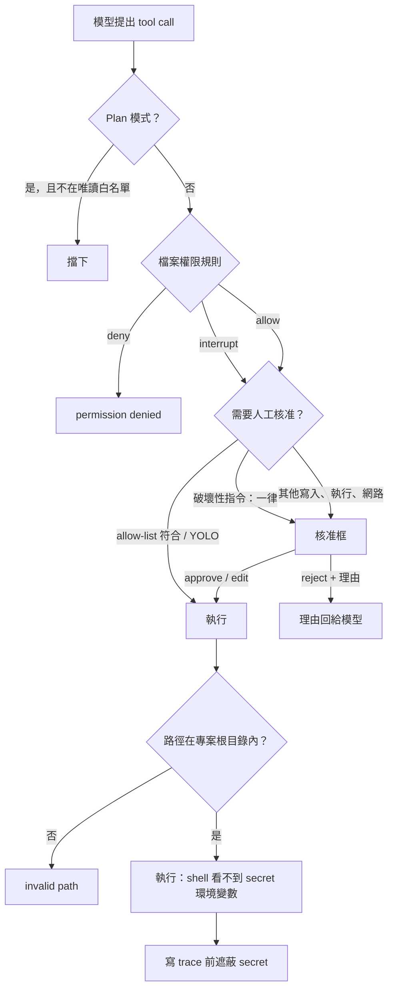

# 08 安全與權限

## 問題

Coding agent 在使用者的電腦上讀寫檔案、執行任意 shell 指令，而控制它的是一個會出錯、也可能被 prompt injection 的 LLM：

- **破壞性操作**：`rm -rf ~`、`git reset --hard` 丟掉未提交的修改、`git push --force`。
- **秘密外洩**：quill 把 `~/.quill/.env`（`OPENROUTER_API_KEY`、資料庫連線字串……）載入自己的環境，而 shell 指令繼承整個環境；`env`、`printenv` 或測試程式的錯誤輸出會把 key 帶進對話、trace，甚至送到 tracing 服務。
- **路徑逃逸**：`../../etc/passwd`、指向外部的 symlink。
- **SSRF**：`fetch_url` 被誘導去打 `169.254.169.254` 或內網服務。
- **本機 GUI 被其他網頁呼叫**：任何網站都可以對 `127.0.0.1` 發請求。
- **惡意 repo**：clone 下來的專案 `.env` 偷偷打開 tracing，把對話送出去。

## 業界怎麼做

- **Claude Code**：macOS Seatbelt、Linux bubblewrap，檔案與網路兩層隔離。
- **Codex**：read-only / workspace-write / danger-full-access 三種 sandbox，搭配獨立的 approval policy。

## 我的立場：誠實標示沒有 OS sandbox，在其他層盡量擋

README 與 `--help` 明確寫出「shell 指令沒有 sandbox，核准後可以存取整台機器；`-y` 等於沒有保護」。OS 層 sandbox（seatbelt / bwrap）沒做，理由是平台相依、而且無法在 regress 評測中驗證（「每個抽象都要可觀察」）。其餘以多層防護處理：

---

## 1. 路徑沙箱（virtual mode）

[backend/filesystem.go](../../backend/filesystem.go)：專案根目錄當作 `/`；先 `EvalSymlinks` 解析真實路徑，確認仍在根目錄內才操作。`..` 與 symlink 逃逸都有測試；刪除 symlink 只刪 link。

## 2. 人工核准（HITL）

實作：[middleware/hitl/hitl.go](../../middleware/hitl/hitl.go)、[code/agent/agent.go](../../code/agent/agent.go) 的 `DefaultInterruptOn`。

| 需要核准 | 不需要 |
|---|---|
| `write_file`、`edit_file`、`apply_patch`、`delete`、`execute`、`run_tests`、`diagnostics`、`web_search`、`fetch_url`、Context7、啟動 web-researcher 的 `task` | `ls`、`read_file`、`grep`、`glob`、`git_status`、`git_diff` |

- **四種決策**：approve、edit（修改參數後執行，並取代存下的 assistant 訊息中的參數）、reject（理由回傳給模型）、respond（使用者的回答直接當工具結果，`ask_user` 用）。
- **核准框顯示 diff**：寫入 / 編輯 / patch 顯示對磁碟現有檔案的 unified diff。
- **各介面行為**：TUI `a/r/A`；`-n` 且 stdin 是終端機時逐一 `[y]es / [a]ll / [N]o / 理由`；**`-n` 但 stdin 不是終端機（管線、CI）時自動拒絕，並告訴模型沒有人可以核准**，而不是卡住等輸入。
- 設定項：`When`（只對符合的呼叫中斷）、`Always`（YOLO 下仍中斷，`ask_user` 用）、`AlwaysWhen`（符合時一律中斷，破壞性指令用）、`Describe`（每個呼叫的說明）。

## 3. Shell allow-list

實作：[code/agent/shell_allow.go](../../code/agent/shell_allow.go)。

- 指令以 `|`、`;`、`&&`、`||` 切段，**每段的第一個字**都在清單內才免核准。
- 含 `$(`、反引號、`$VAR`、`${`、重導向（`>`、`<`、`>>`、`<<`）、背景 `&`、換行、tab 的指令**一律要核准**。所以 `ls | grep x` 免核准，`ls "$(rm -rf /)"` 與 `ls &` 仍會問。
- `"recommended"` 展開成唯讀指令（ls、cat、grep、wc、diff ...）；`"all"` 必須單獨使用。
- `run_tests` / `diagnostics` 會依專案啟動不同 runner，清單要包含**全部可能的 runner** 才免核准（`go`、`npx`、`npm`、`node`、`python3`、`python`、`ruff`）。

## 4. 破壞性指令（R9）

實作：[code/agent/shell_risk.go](../../code/agent/shell_risk.go)。用固定的 regex 規則判定，**不靠 LLM**：

| 規則 | 原因 |
|---|---|
| `rm -r` 根目錄、家目錄、`.`、`*`、`..` | 遞迴刪除整個系統、家目錄或專案 |
| `git reset --hard` | 丟掉所有未提交修改 |
| `git clean -f` | 刪除未追蹤檔 |
| `git checkout -- .` / `git restore .` | 丟掉所有檔案的修改 |
| `git stash drop/clear` | 刪除 stash |
| `git push --force` / `-f` / `--force-with-lease` | 覆寫遠端歷史 |
| `curl ... \| sh` | 執行從網路下載的腳本 |
| `mkfs`、`dd of=/dev/...` | 覆寫磁碟 |
| fork bomb、`shutdown`、`reboot` | — |

- **互動模式**：`AlwaysWhen` 讓它**一律送核准**，即使用了 `-y`、allow-list 是 `"all"`、或本次已選擇自動核准；核准框寫明原因。
- **Headless 且自動核准**：沒有人能核准，`destructiveGuard` 直接回錯誤，請 agent 改用範圍較小的指令，或把確切指令告訴使用者讓他自己跑。
- **避免誤判**：`rm -rf build`、`git checkout -- src/a.go` 不會命中（table-driven 測試涵蓋）。
- **對評測的影響**：歷史 trace 的 133 個 `execute` 指令中 0 個命中，所以加上它不影響 benchmark 行為。

注意：驗證閘門自己的 HEAD baseline 會跑 `git reset --hard` 與 `git clean -fd`，但那是閘門的程式直接透過 backend 執行，不經過 agent 的工具呼叫，也有 stash + ref 保護（見 06）。

## 5. 環境變數最小化（R9）

實作：[backend/secrets.go](../../backend/secrets.go)、`LocalShellOptions.HideSecretEnv`。

- shell 子程序看不到名稱像 credential 的變數：`*_API_KEY`、`*_TOKEN`、`*_SECRET`、`*_PASSWORD`、`*_CONN_STRING` 等。
- 需要時以 `QUILL_SHELL_PASS_ENV=GITHUB_TOKEN,NPM_TOKEN` 放行。
- **用黑名單而不是白名單**：專案常依賴任意環境變數（`NODE_ENV`、`DATABASE_URL`、`GOPATH` ...），白名單會讓測試莫名其妙失敗。
- 測試確認 `TOKENIZERS_PARALLELISM` 這類名稱不會被誤判。

## 6. Trace 遮蔽（R9）

實作：[code/trace/redact.go](../../code/trace/redact.go)。

- Store 建立時記下 credential 變數的**值**（≥ 8 字元），寫入前連同常見 token 格式（`sk-...`、`ctx7sk-...`、`ghp_...`、`AKIA...`、`xox?-...`、`AIza...`）與 URL 中的密碼換成 `[REDACTED]`。
- 只替換 JSON 字串內容，紀錄仍是合法 JSON；處理 JSON 跳脫字元與跳脫換行。
- `risk-assessment-...` 這類字串不會被誤遮。

這三項（破壞性指令、環境、trace）是安全底線，**沒有 ablation 開關**。

## 7. 檔案權限規則（SDK 功能）

實作：[middleware/permissions/permissions.go](../../middleware/permissions/permissions.go)。

- 規則：`{operations: [read|write], paths: [glob], mode: allow|deny|interrupt}`，**依序比對、第一個符合的生效、都不符合就 allow**（對齊 Python）。
- 用 doublestar 比對：和 Python 的 wcmatch 不同，`*` 與 `**` 也會匹配 dotfile，所以 deny `/secrets/**` 會蓋到 `/secrets/.env`（更安全的預設）。
- deny 時工具回 permission denied；`ls` / `glob` / `grep` 的結果會被過濾；interrupt 規則自動產生 HITL 設定。
- **subagent 繼承權限，但 interrupt 改成 deny**：subagent 目前無法暫停父 run 等核准，如果保留 interrupt，每個需要核准的呼叫都會失敗；改成 deny 是比較安全的明確行為。

## 8. Plan 模式的唯讀限制

[middleware/planmode/planmode.go](../../middleware/planmode/planmode.go)：只開放 `ls`、`read_file`、`glob`、`grep`、`web_search`、`fetch_url`、Context7、`git_status`、`git_diff`。**兩層都擋**：`WrapModelCall` 把其他工具從清單中拿掉（模型看不到），`WrapToolCall` 再擋一次（就算模型硬呼叫也不會執行）。`task` 只能委派給唯讀 subagent。

## 9. 網路：SSRF 防護

[code/tools/fetch.go](../../code/tools/fetch.go)：

- `BlockedIP` 拒絕私有、loopback、link-local（含雲端 metadata 的 `169.254.169.254`）、multicast、保留與文件用網段；IPv4-mapped 與 6to4 位址會取出內嵌的 IPv4 再檢查；
- **DNS 解析一次、連線釘在驗證過的 IP 上**：自訂 `DialContext` 只撥驗證過的位址，所以第二次 DNS 查詢回傳內網 IP 也沒用（防 DNS rebinding）；不走 proxy；
- **不自動跟隨 redirect**（`CheckRedirect` 回 `ErrUseLastResponse`），自己處理最多 5 跳，每一跳都重新解析、驗證、釘 IP，避免「公開網址 302 到內網」繞過。

## 10. 本機 GUI 的存取控制

[code/gui/gui.go](../../code/gui/gui.go)：

- 只綁 loopback，且每個請求的 `Host` 必須是 loopback（防 DNS rebinding）；
- 每次啟動產生隨機 session token，放在網址的 `#token=`（fragment 不會送進 server log）；API 必須帶 token，用 `subtle.ConstantTimeCompare` 比對；
- 瀏覽器有送 `Origin` 時必須同源。

## 11. 供應鏈：專案 `.env` 不能打開 tracing

Stage 18e：專案目錄的 `.env` **不能設定** `LANGSMITH_*` / `LANGCHAIN_*`，只能放在 shell 或 `~/.quill/.env`。避免 clone 下來的 repo 偷開 tracing，把你的對話與程式碼送到別人的 LangSmith 專案。`.env` 載入時 shell 已設定的變數永遠優先。

## 面試講法

> 「我沒有做 OS 層 sandbox，而且在文件與 `--help` 裡明確寫出來，因為假裝安全比不安全更糟。其他層我盡量擋：路徑解析 symlink 後鎖在專案根目錄；寫入、執行、網路要人工核准，核准框顯示 diff；allow-list 只看每段指令的第一個字，含命令替換、變數展開、重導向的一律要問；破壞性指令用固定規則判定，即使開了自動核准也一定要人確認，headless 沒人可問就直接拒絕；shell 子程序看不到 API key；trace 寫入前遮蔽 secret；fetch 擋內網位址且每次 redirect 都重新檢查。」

可能的追問：

- **為什麼破壞性指令用 regex 不用 LLM 判斷？** 確定性、零成本、可測試；LLM 判斷本身也會被 prompt injection。
- **環境變數為什麼用黑名單？** 白名單會讓大量正常專案的測試因缺變數失敗；黑名單針對的是「名稱像 credential」的變數，並提供放行機制。
- **subagent 的核准怎麼辦？** 目前 subagent 不能暫停父 run，所以權限的 interrupt 變 deny；啟動 web-researcher 的 `task` 本身需要核准，核准後裡面的網路呼叫不再逐一詢問。
