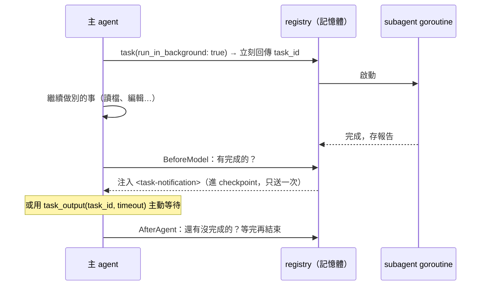

# 10 Subagent 與任務委派

## 問題

- 讀大量程式碼找答案會把主 agent 的 context 塞滿，之後的推理都要背著這些內容。
- 多步驟的網路研究很花時間，主 agent 等的時候什麼都不能做。
- 但 multi-agent 很貴，而且平行寫同一份程式碼會互相矛盾。
- 怎麼隔離 context、共用預算、傳遞取消、算清楚成本？

## 業界依據

- **Anthropic《Multi-agent research system》**：multi-agent 約用 15 倍 token；coding 任務可平行的部分比研究少。
- **Cognition《Multi-agents》**：平行寫同一個產出物會互相矛盾；有效的是**唯讀的研究 / 審查型** subagent。
- **Claude Code**：subagent 可在背景執行，完成時以通知送回主 agent。

## 我的立場

所有本地 subagent 跑**同一個 5-node 迴圈**，差別只在 prompt、工具與 middleware。預設推薦的委派對象是**唯讀**的 `explorer`。不做 Planner / Reviewer 這類「另一個大腦」。

---

## 1. `task` 工具的基本行為

實作：[middleware/subagents/subagents.go](../../apps/agent/middleware/subagents/subagents.go)。

- 參數：`subagent_type`、`description`（要完整交代任務，subagent 看不到主 agent 的對話）。
- **context 隔離**：subagent 從一則只有任務描述的 user 訊息開始，只回傳最後的報告給主 agent，中間的讀檔、搜尋都不進主 context。
- **state 共享有界**：只傳可分享的 state key；private key（例如摘要事件）與 `messages`、`structured_response` 不傳；subagent 改過的 `files`（StateBackend 下）會回寫。
- **structured response**：宣告式 subagent 有 `ResponseFormat` 時，`task` 回傳 JSON。
- **取消傳播**：subagent 跑在 tool call 的 context 上，主 run 取消就一起取消。
- **成本與時間共用**：同一個 metered model、同一個 deadline。
- **平行**：同一回合多個 `task` 可以同時執行；唯讀 subagent 的 `task` 宣告為 Read 副作用，不會阻擋其他讀取（見 03）。

## 2. 六種 subagent

| 類型 | 工具 | 用途與限制 | 實作 |
|---|---|---|---|
| `general-purpose` | 主 agent 的全部工具 | 預設存在；**不繼承 HITL**，權限的 interrupt 改成 deny（subagent 不能暫停父 run 等核准） | [assembly.go](../../apps/agent/assembly.go) `generalPurpose` |
| `explorer` | `ls`、`read_file`、`glob`、`grep`、`git_status`、`git_diff` | 唯讀；描述寫明「單一定義或用法，直接 grep / read_file 比較快」 | [code/agent/explorer.go](../../apps/agent/code/agent/explorer.go) |
| `web-researcher` | web 工具 + 唯讀檔案工具 | 有 Brave / Context7 key 才存在；每次最多 4 次搜尋、8 頁；回報結論、引用 URL、適用版本、來源衝突；啟動它的 `task` 需要核准 | [code/agent/researcher.go](../../apps/agent/code/agent/researcher.go) |
| 自訂（AGENTS.md） | 繼承主 agent 工具 | `~/.quill/<agent>/agents/<name>/AGENTS.md` 或 `<project>/.quill/agents/<name>/AGENTS.md`（專案優先），frontmatter 可指定 model；格式錯直接報錯並附路徑；不能蓋掉內建的 | [code/subagents](../../apps/agent/code/subagents/subagents.go) |
| fork | 同 general-purpose | **繼承完整對話**；必須明確選擇 | [middleware/subagents/fork.go](../../apps/agent/middleware/subagents/fork.go) |
| async remote | 5 個工具操作遠端 LangGraph server | `start/check/update/cancel_async_task`、`list_async_tasks`；由遠端控制生命週期 | [middleware/asyncsubagents](../../apps/agent/middleware/asyncsubagents/asyncsubagents.go) |

### 唯讀限制怎麼實作

explorer 與 web-researcher 用 `researchLimits`：工具清單只給唯讀工具，`WrapToolCall` 再擋其他工具，並計數搜尋 / 擷取次數。

### Fork 的細節（Stage 22）

- 輸入：父 agent 的對話**拿掉最後一則帶 tool_calls 的 AI 訊息**（就是正在呼叫 fork 的那一則，否則會有懸空的 tool call），套用摘要事件（只拿壓縮後的歷史），再接上 preamble 與任務。
- system prompt：先父 agent 的，再接自己的；沿用父 agent 的 skills、memory 與呼叫端 middleware（同名時自己的覆蓋）。
- **防遞迴**：fork 的工具清單和父 agent 一致（包含 `task`，讓 prompt cache 一致），但 state 有 `_quill_forked_context` 標記，呼叫 `task` 時回拒絕訊息；這個 key 不會回傳給父 agent。

## 3. 背景執行（Stage 14e）

實作：[middleware/subagents/background.go](../../apps/agent/middleware/subagents/background.go)。

- **結果送回的兩條路**：`BeforeModel` 注入 `<task-notification>` 訊息；或主 agent 用 `task_output(task_id, timeout)` 主動等。
- **run 會等背景 task 結束才收尾**（`AfterAgent` 回到 model，讓主 agent 看到通知）。
- **取消 run 會一併取消**背景 task。
- **registry 只在記憶體**：server 重啟或 run 停下來等核准時，背景 task 中止，下一輪收到 cancelled 通知。
- 測試：barrier 證明背景 task 與主 agent 真的重疊執行、通知只送一次、`task_output` 等待與逾時、取消傳播、失敗回報，並以 `-race` 壓測。

## 4. 可觀察性：namespace 與用量

- **事件 namespace**：串流時 subagent 的事件帶 `task:<tool call id>`，TUI / GUI 把 subagent 的 LLM 呼叫與工具呼叫縮排在對應的 task 下，平行的 subagent 有各自的編號（#1、#2）。
- **用量**（Stage 19）：`task` 結果、`task_output` 結果、`<task-notification>` 的 metadata 都帶 `subagent_usage`（依 `model_name` 加總，含巢狀 subagent）；thread 的用量報表把 subagent 的 token 與成本算進去，另外列小計。
- **quillbench 指標**：`subagent_llm_calls`（namespace 以 `task:` 開頭的模型呼叫數）、使用 subagent 的 attempt 比例、平均 task 呼叫數。

## 5. 委派要靠 prompt 引導（Stage 17、R7）

### 問題

所有 quillbench trace 裡 `task` 呼叫數都是 **0**。接線沒問題（FakeModel 測試與手動呼叫都能跑），是 prompt 沒告訴模型什麼時候該委派，而且唯一適合讀程式碼的是權限過大的 general-purpose。

### 做法

- [code/agent/delegation.go](../../apps/agent/code/agent/delegation.go) 產生 `## Subagents` 段落：何時委派、何時自己做、要完整交代任務、**委派後不要自己重做**（手動測試看到主 agent 委派 web-researcher 後又自己重複搜尋）。
- 新增唯讀的 `explorer`。
- Plan 模式下 `task` 只接受唯讀 subagent。

### 結果與修正

- Stage 17：smoke50 前 5 題中 20% 的 attempt 用了 subagent（之前 0%）。
- R7：歷史 trace 中只有 1 個 attempt 用了 subagent（b398，4 次、每次 9–15 步、回傳最多約 1.3k tokens），原本計畫的「30 步上限、2k tokens 回傳上限」都不會觸發，所以**沒有新增程式碼**；反而把 explorer 與 web-researcher 描述中的「proactively」拿掉，避免過度委派。

## 6. 明確不做

| 不做 | 理由 | 重新考慮的條件 |
|---|---|---|
| Reviewer subagent | 驗證閘門 + diff review 是確定性的、針對已知失敗 | 閘門上線後仍有語意性 regression 漏網 |
| 平行寫檔的 multi-agent | 互相矛盾（Cognition） | — |
| 強制委派 | 多 agent 約 15 倍 token；樣本中定位不是瓶頸（first gold file touch 在第 1–4 步） | 大型 repo 的定位指標變差 |

## 面試講法

> 「subagent 我主要用在 context 隔離：explorer 是唯讀的，負責讀大量程式碼、只回報結論，中間的讀檔不會進主 agent 的 context。所有 subagent 跑同一個迴圈，差別只在 prompt 和工具。我也做了背景執行：主 agent 啟動研究後繼續工作，結果以通知注入；run 結束前會等背景任務，取消會一路傳下去。有個有趣的發現：一開始 trace 裡的委派次數是 0，不是程式問題，是 prompt 沒有告訴模型什麼時候該委派；加了規則後變成 20%，但我之後又拿掉『主動委派』的字眼，因為資料顯示定位不是瓶頸，過度委派只會增加成本。」

可能的追問：

- **subagent 為什麼不能用 HITL？** 目前 subagent 的 run 無法讓父 run 暫停等待核准；與其讓每個需要核准的呼叫失敗，不如明確改成 deny，並把核准放在啟動 subagent 的 `task` 上。
- **fork 為什麼還保留 `task` 工具？** 讓工具清單與父 agent 相同，prompt cache 前綴一致；遞迴由 state 標記擋下。
- **背景 task 為什麼不持久化？** 持久化需要處理重啟後的 goroutine 重建與副作用重放；目前選擇「中止並通知」，狀態保證一致。
