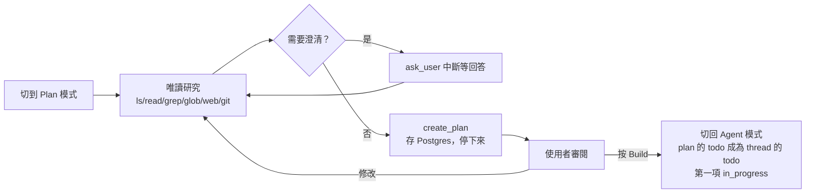

# 11 規劃、Todo 與人機互動

## 問題

- **假規劃**：trace 顯示 agent 在讀任何檔案之前就呼叫 `write_todos`，清單是三條通用步驟（「檢視專案」「實作」「跑測試」），沒有資訊量。
- **規劃回合浪費時間**：520 個主 agent 回合中有 68 個**只**呼叫 `write_todos`（約 995 秒）；`write_todos` 佔 12.5% 的模型回合。
- 使用者想先看計畫、同意後才動手。
- 需要問使用者問題時，即使開了自動核准也要停下來。
- 使用者要能看懂 agent 在做什麼：每一步的指令、輸出、diff、送給 LLM 的完整內容。

## 業界參考

Cursor 與 Claude Code 都區分「執行中會修正的 todo」與「唯讀研究後產出、等使用者同意的 plan」。

---

## 1. `write_todos`（Stage 13a、15c）

實作：[middleware/todolist/todolist.go](../../middleware/todolist/todolist.go)。

- 項目：`{id, content, status, notes?}`；狀態 `pending` / `in_progress` / `completed` / `cancelled`。
- **`merge: true` 依 id 部分更新**：只送變動的項目，不用每次重送整份清單（省 token）；舊資料自動補 id。
- prompt 改成**先探索再寫**、項目要具體可驗證；還沒查清楚的寫成 `Investigate: ...`。
- Stage 15c：明說 `write_todos` 可以和其他工具放在**同一個回應**（只是不能同一回應呼叫兩次），減少「只更新 todo」的回合。
- TUI / GUI 顯示 checklist 與 notes。

## 2. Plan 模式（Stage 13c–e）

實作：[middleware/planmode](../../middleware/planmode/planmode.go)。

- **模式透過 `RunConfig.Configurable` 傳遞**：同一個 agent 實例，每個 run 可以是 agent 或 plan 模式，不用重建 agent。
- **唯讀兩層擋**：`WrapModelCall` 過濾工具清單（模型看不到寫入工具），`WrapToolCall` 再擋（硬呼叫也不會執行）。
- `task` 只能委派給唯讀 subagent（explorer、web-researcher），Plan 模式 prompt 列出可用的 subagent。
- **計畫的格式**：發現（附路徑）、做法、驗證方式、風險，結尾是 todo checklist；**計畫是查證過的結果，不應再有待調查的項目**（和 todo 的 `Investigate:` 相反）。
- 存進 Postgres（id 為 `<thread>-<名稱>`）；同一個 thread 再進 Plan 模式會覆寫同一個計畫。
- 核准計畫只是標記，要按 Build（或 `/build`）才開始實作。
- Plan 只限 interactive；headless 請求 plan 模式會被拒絕。

**真模型 smoke**：plan 模式只提供 10 個唯讀工具；模型先呼叫 `ask_user`，回答後讀檔並 `create_plan`，寫出含 Findings / Approach / Verification / Risks 與 todo 的計畫；`build_plan` 後 todos 與計畫 id 一致，模型依序以 `write_todos`（含 merge 與 notes）推進並全部完成。

## 3. `ask_user`（Stage 13b）

實作：[code/askuser/askuser.go](../../code/askuser/askuser.go)。

- 選擇題提問（可多選，另有自由輸入的 Other）。
- 走 HITL 中斷，但只允許 respond / reject；設定 `InterruptOnConfig.Always`，**YOLO 模式下仍會中斷**——它是在問問題，不是在要權限。
- 只在 interactive 註冊；headless 的 prompt 明確說「不要問澄清問題」。
- GUI 在卡片上作答；TUI 用方向鍵 / 數字選、空白鍵切換多選；REPL 輸入逗號分隔的編號或直接打字。

## 4. 介面

### 4.1 瀏覽器 GUI（Stage 9，預設）

實作：[code/gui](../../code/gui/gui.go)（Go）、`code/gui/web`（React + Vite，約 5,400 行）。

- **單一 binary**：建置結果 `code/gui/dist` 進版控並 `embed`，一般 `go build` 不需要 Node。
- **時間軸**：保留 TUI 的收合結構（`main · LLM #n`、tool call 樹、subagent 縮排），虛擬捲動，可一路捲到 thread 開頭。
- **展開詳情**：grep 依檔案分組並標出命中、read_file 帶行號、execute 顯示終端輸出與 exit code、edit/write 以 GitHub 風格 diff（unified / split）呈現；另有 Arguments、Output、Raw JSON 分頁。
- **LLM 檢視器**：點 LLM 那一行打開側欄，看這次呼叫**實際送出的 messages**（標出和上一次相比新增的部分）、回覆、提供的 tools 與 token 用量。這對 debug prompt 與 cache 非常有用。
- 每個 turn 結尾有 Files changed 摘要；核准卡片顯示 diff 預覽。
- 篩選 Edits / Commands / Errors / LLM calls、搜尋、鍵盤操作（`j/k`、`e`、`/`、`i`、`G`）。
- 存取控制見 08；斷線續接見 09。

### 4.2 TUI（Stage 6e、6.5b、7e）

Bubble Tea 全螢幕介面：

- token 串流、核准框（`a` 核准 / `r` 拒絕附理由 / `A` 本次全部核准）、unified diff 預覽。
- **效能**：已完成的訊息依寬度快取渲染結果（每個寬度只渲染一次）；捲上去時串流不會把畫面拉回底部；spinner 的 tick 只重繪進行中的 entry。
- assistant 訊息用 glamour 渲染 markdown。
- subagent 活動巢狀顯示，等待模型時顯示 thinking 列與經過時間，取消後不殘留 spinner。

### 4.3 REPL 與 headless

- 非終端機或 `-plain` 時改用逐行 REPL。
- 腳本 / CI：`-q`（stdout 只有回覆）、`-no-stream`、`-timeout`（逾時 exit 124，`Ctrl-C` exit 130，對齊 `timeout(1)` 慣例）、`quill threads -json`（帶 `schema_version` 的 JSON envelope）。

### 4.4 共用的指令系統（Stage 10c–e）

- `commands.Registry`：alias、未知指令建議、help；TUI / REPL 共用 handler，GUI 透過 `GET /commands` 做自動完成。
- `/model [spec] [--default]`：執行中切換模型，subagent 跟著換，thread 記住模型，`--default` 寫回 config.toml。
- `/tokens`、`/context`、`/cost`：context 用量百分比、依價格表（含 cache read 價）計算成本。
- `/compact`、`/plan`、`/build`、`/yolo`、`/new`、`/threads`、`/resume`。

## 5. 設定

`~/.quill/config.toml`，優先順序 **flag > 環境變數 > config.toml > 預設**；檔案不存在全用預設，格式錯誤時啟動失敗並指出行號（fail fast）。`.env` 載入順序：shell 已設定的永遠優先 > 專案 `.env`（往上找第一個）> 全域 `~/.quill/.env`。

## 面試講法

> 「我區分 todo 和 plan：todo 是執行中會修正的追蹤清單，可以有待調查的項目；plan 是在唯讀模式下研究完、使用者按 Build 才會轉成 todo 的確定性計畫。Plan 模式的唯讀是兩層擋：模型看不到寫入工具，就算硬呼叫也會被擋。另外 trace 顯示 12.5% 的模型回合只在更新 todo，所以我加了 merge 部分更新、並明說 todo 可以和其他工具在同一個回應。」
>
> 「GUI 最實用的是 LLM 檢視器：每次模型呼叫實際送出的完整 messages 都存在 trace 裡，而且標出和上一次相比新增的部分，debug prompt 和 cache 前綴問題時直接看得到。」

可能的追問：

- **為什麼 GUI 預設而不是 TUI？** coding agent 的輸出（diff、長指令輸出、巢狀 subagent）需要展開 / 收合與搜尋，瀏覽器比終端機適合；TUI 仍保留給純終端環境。
- **dist 進版控不會很髒嗎？** 換來的是 `go install` 就能用、不需要 Node；改前端時用 `make web` 重建，有 `make web-test`。
