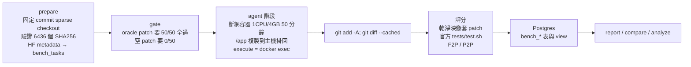

# 12 可觀測性與評測

## 問題

- **怎麼知道改動有沒有讓 agent 變好？** 靠感覺或幾個手動例子會被雜訊騙。
- **失敗時看不到原因**：agent 跑了 60 步，問題出在哪一步？那一步模型實際看到了什麼？
- **評測本身要可信**：指標算錯、評分器有 bug、環境不一致，結論就全錯。
- **評測很貴**：每跑一次 smoke50 要錢要時間，不能每改一行就跑。

---

## 1. Trace：記錄一切（Stage 9a）

實作：[code/trace](../../code/trace/trace.go)。

| 記什麼 | 怎麼記 |
|---|---|
| 每次模型呼叫的**完整 request**（messages、tools、settings）與回覆、token 用量 | `trace.Model` 包住模型；回覆標上 `trace_seq`，GUI 可以從訊息跳到對應的 LLM 呼叫 |
| 寫入 / 編輯 / 刪除的**完整 unified diff** | `trace.WrapBackend` 包住 backend，保留 execute / delete 能力 |
| subagent 的呼叫 | `trace.Middleware` 讓 subagent 的紀錄帶 `task:<id>` namespace |
| `fetch_url` 內部擷取網頁的模型呼叫 | 標成 `web_extract`，GUI 在該 tool call 的詳細內容顯示 |

- **去重**：每次模型呼叫的 messages 幾乎都是上一次的前綴延伸。每個不同的訊息以 sha256 存成一個 blob，呼叫紀錄只存 hash 列表；並記錄「從第幾則開始是新的」（`new_from`），GUI 據此標出新增的部分。
- 存在 Postgres（`quill_trace_records`、`quill_trace_blobs`）；GUI 先載入摘要（不含 blob 內容），點開才讀詳細內容。
- 寫入前遮蔽 secret（見 08）。
- 重開後序號延續，blob 去重也延續。

### LangSmith（Stage 18，預設關閉）

- SDK 層的 `tracing.Tracer` 介面；agent loop 在 invoke、model call、tool call 開 run，subagent 從 ctx 接上 parent，形成 run tree。
- `langsmith` 套件：背景批次送 `POST /runs/batch`（UUIDv7、dotted_order、8MB 分批、429/5xx 重試 3 次），**送不出去只記 log、不影響 run**。
- 必須明確開啟；專案 `.env` 不能開（見 08）。

## 2. quillbench：SWE-bench Pro V2 評測框架（Stage B1–B4）

### 為什麼選 SWE-bench Pro

真實 repo、真實 issue、官方 verifier、多語言（Go / Python / JS / TS），而且有 F2P（要修好的測試）與 P2P（不能弄壞的測試）的區分——後者正好量到「regression」這類失敗。

### 流程

- **子集**：smoke50 依語言（go 20 / python 18 / js+ts 12）、HARD 比例、11 個 repo 分層抽樣，同一個 seed 輸出相同；另有 `regress-v1`（7 題，歷史上不穩定或失敗的題）與 `regress-unstable`（3 題）。
- **遵照官方 locked protocol**：容器 `--network none`、沒有 web 工具、不載入使用者層設定。
- **DockerExecBackend**：檔案工具直接讀寫主機上的 workspace 副本（快），`execute` 用 `docker exec` 在容器內執行（環境正確）。
- **評分器先驗收自己**（`quillbench gate`）：官方答案必須全過、空 patch 必須全不過。實機結果 oracle 50/50、nop 0/50、infra error 0。
- agent 的 `/.quill` artifacts 寫進 `.git/info/exclude`，不會被收進 patch。

### 踩過的坑

- 官方 `test.sh` 只在 exit trap 建立 `/logs/verifier`（Harbor 會預先掛載），不先 `mkdir -p` 的話 `output.json` **靜默遺失**。gate 抓到了這個問題。
- `docker cp` 讓 git index 全部失效，`git status` 6–8 秒（見 04）。
- `bench_scored_attempts` view 用 `a.*`，新欄位插在中間導致 `CREATE OR REPLACE VIEW` 失敗；改成 `DROP VIEW ... CASCADE` 後在同一份 schema 內重建所有相依 view。
- 早期 run 沒記 commit、有的是 dirty tree → R1 起每個 run 記錄 dirty diff hash 與 prompt template hash；舊資料缺的欄位標成 unknown，**不補造**。

## 3. 指標（R1：先修好量測再改 agent）

R1 的目標是「不改 agent 行為，只讓量測可信」：

- **修正**：`TestRuns` 原本只算 `execute`，漏掉 `run_tests`（某個 run 全部記成 0，重算後是 2–8）。
- **新增 `Process`**（`bench_attempts.process` JSONB，舊資料 NULL = unknown）：

| 指標 | 用途 |
|---|---|
| 重複呼叫數、最大重複次數 | 找盲目重試 → R7 |
| 各工具輸出字元 | 找 context 大戶 → R6（read_file 36–56%、grep 16–32%、git_diff 14–19%、execute ≤6%） |
| verify 擋下次數 | 閘門效果 |
| 只寫 todo 的回合數 | 規劃浪費 |
| tool wall time（每回合取最慢） | 平行效果（wall / sum ≈ 0.7–0.9） |
| first_gold_src_touch_step、gold_src_recall | 定位能力（結果：第 1–4 步就碰到正確檔案 → 定位不是瓶頸） |
| tools hash | 工具清單是否改變 |
| baseline verdicts | HEAD baseline 每次的判定（R10） |

- 其他：步數、token（含 cache read）、成本、agent 時間、subagent 模型呼叫數、cache 命中率、peak context。

## 4. 報表與統計（Stage B4）

| 指令 | 內容 |
|---|---|
| `quillbench report <run>` | 解題率與 **Wilson 95% 區間**、分語言 / repo / 難度、失敗分類、過程指標 |
| `quillbench compare <base> <new>` | 同題配對：**精確 McNemar 檢定**、**paired bootstrap** 信賴區間、翻轉的題目清單 |
| `quillbench history` | 歷次執行 |
| `quillbench refs import` + `compare -ref` | 匯入別的 harness（mini-swe-agent 等）的逐題成績做同題比較 |
| `quillbench analyze <run>...` | 從 trace 重算指標、分類失敗、離線重播、元件觸發次數 |

實作：[code/bench/stats.go](../../code/bench/stats.go)。為什麼用這些：

- **Wilson** 而不是常態近似：樣本小（10–50 題）、比例接近 0 或 1 時常態近似會給出荒謬的區間。
- **McNemar**：兩個版本跑同一組題目，資料是配對的；只看「A 解出 B 沒解出」與相反的題數。Stage 12 的 A/B 是 8/10 vs 8/10、p = 1.0——**10 題看不出差異**，這是我在文件裡誠實記錄的。
- **paired bootstrap**：成本、步數這類連續指標的配對差異區間，固定 seed 保證可重現。

## 5. 失敗分類與離線分析

`quillbench analyze` 從 trace 判斷失敗類型，例如：

- `regression_unnoticed`：P2P 失敗，agent 從沒在工具輸出中看到那些測試失敗；
- `regression_dismissed`：看到了，但判定無關；
- `incomplete_fix`、`wrong_solution`、`model_error`、`budget`、`agent_timeout`、`infra_error`（不算分，可 `-retry-infra` 重跑）。

**離線重播**：ProgressMonitor（純函式、從對話推導）可以在歷史 trace 上重播，算出「如果當時有它，會介入幾次」，零成本評估。（masking 的離線重播誤判見 05。）

**元件觸發次數**（架構審查用）：每個元件實際觸發幾次——verify gate 各種類、HEAD baseline 判定、progress 拒絕 / 附註、budget、危險指令、version guard、grep regex 重試、service hint、shell 截斷。**從不觸發的元件就是刪除候選。**

## 6. 評測紀律

- **重構期間不跑付費評測**：R0–R9 只用 deterministic 測試（單元、整合、`-race`、crash 注入、FakeModel 端到端）與歷史 trace 的離線分析。
- **把 benchmark 失敗變成 FakeModel 測試**：例如 `TestHeadlessAgentCannotDismissRegression` 重現 bd80 的劇本，之後每次 `make test` 都會跑。
- **全部完成後跑一次** `regress-v1` × 2，和歷史 baseline 比較。代價是無法歸因到單一 Stage，所以**每個新行為都有開關**（`quillbench run -disable baseline,diff_review,test_edits,progress,budget`，記在 run config），有退步時用開關做消融。
- **先 probe 再實作**：R4 花約 $0.001 確認 provider 不回傳推理內容，省下一個無效的改動。

## 7. 最終評測結果

`regress-v1` × 2，commit `03e3e16`（R0–R9），`openrouter:openai/gpt-6-luna-pro`，共 $2.19：

| | attempts | 解出 | $ / attempt | input tokens (M) | cache % | peak ctx (k) | 步數 | 分鐘 |
|---|---|---|---|---|---|---|---|---|
| 歷史 baseline | 22 | 15（68%） | 0.170 | 5.25 | 81 | 143 | 37 | 15.2 |
| R0–R9 | 14 | 10（71%） | 0.157 | 4.49 | 81 | 116 | 60 | 19.1 |

步數 +60% 追到 observation masking → 刪除。R10（刪除 masking 後，3 題各 1 次，$0.26）：

| 題 | 解出 base / R0–R9 / R10 | 步數 base → R0–R9 → R10 | `read_file` 次數 |
|---|---|---|---|
| 8168 | 4/4 · 1/2 · 0/1 | 36 → 90 → 32 | 53–87 → 16 |
| bd80 | 1/4 · 1/2 · 1/1 | 39 → 68 → 18 | 49–72 → 11 |
| b398 | 0/4 · 0/2 · 1/1 | 64 → 120 → 48 | 144–204 → 52 |

8168 未解是 `incomplete_fix`（F2P 3/4，改到了對的檔，差一個 cover 刪除行為），和 masking 無關。

## 面試講法

> 「我做了自己的評測框架 quillbench，跑 SWE-bench Pro。先驗收評分器：官方答案必須 50/50 全過、空 patch 必須 0/50，這一步就抓到官方腳本會靜默遺失結果的問題。每次模型呼叫的完整輸入都存在 trace 裡，用 hash 去重；指標從 trace 重算，所以定義改了可以回頭重算歷史資料。比較兩個版本用同題配對的 McNemar 與 bootstrap，因為題目少，常態近似不可靠——我也誠實記錄了『10 題 8 比 8、p=1.0，看不出差異』。最重要的用途是架構審查：統計每個元件實際觸發幾次，從不觸發的就刪掉。」

可能的追問：

- **樣本這麼小，結論可信嗎？** 解題率的結論不可信，我也不宣稱；可信的是機制層面的證據（trace 中看到閘門擋下、agent 修好）與大幅度的過程指標變化（步數 +60%、`read_file` 降到 1/3）。
- **為什麼不每個 Stage 都跑評測？** 成本與時間；改用 deterministic 測試 + 離線重播，最後一次性驗證，並用開關保留消融能力。
- **trace 存完整 request 不會很大嗎？** 前綴重複，用 blob 去重後每個不同的訊息只存一次。
