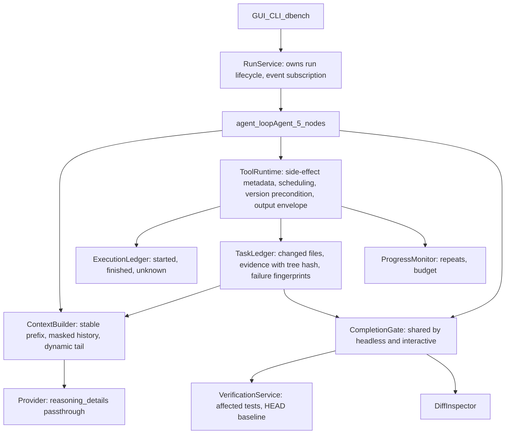
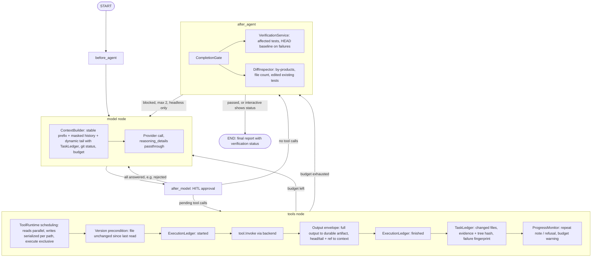

# dcode 系統級重構：最終方案

> 2026-10-02。合併 [reconstruct_pan_cursor.md](reconstruct_pan_cursor.md)（以 dbench trajectory 為依據）與 [reconstruct_plan_gpt6_astra.md](reconstruct_plan_gpt6_astra.md)（以日常使用的系統正確性為依據），並補上兩份都沒有的發現。實作進度與結果記在 [`IMPLEMENTATION_PLAN.md`](../IMPLEMENTATION_PLAN.md) 的 R0–R9。

證據標記：
- **【已證實】**：官方文件、論文、開源程式碼，或本 repo 程式碼與資料直接可見。
- **【公開模式】**：多個系統的公開行為一致，但內部實作沒有公開。
- **【推論】**：我的判斷，需要量測驗證。

閉源系統（Claude Code、Codex 雲端、Cursor、Copilot）只根據公開文件描述，不推測內部 prompt 或演算法。

---

## 1. 決策摘要

1. **保留單一 model→tool loop 與現有 5 個 graph node。** 主流 coding agent 的核心都是簡單的 tool-calling loop，差異在工具介面、context 管理與驗證【公開模式】。dcode 不新增 Planner、Orchestrator、Reviewer subagent，也不做 model router。
2. **優先順序**（使用者決定）：先處理日常使用的系統正確性（過期寫入、工具並行、輸出保存、crash 重放、durable run），再處理 benchmark 已觀察到的失敗（推理內容遺失、P2P regression、context 成本、盲目重試）。
3. **評測**（使用者決定）：重構期間只用 deterministic 測試與歷史 trace 的免費分析。R0–R9 全部完成後，跑一次 `regress-v1`（7 題）× 2，和歷史 baseline 比較。
4. **Deterministic 問題用程式解。** 版本核對、排程、預算、重複偵測、baseline 比對、diff 檢查、context 淘汰都由程式處理；LLM 只負責理解需求、推理未知程式碼、提出修復假設。

## 2. 研究結論

### 2.1 Agent loop 與架構

| 來源 | 內容 | 標記 |
|---|---|---|
| Codex | loop 為「模型推論 → 執行工具 → 輸出附加到輸入 → 重複」；每次請求都是前一次的完全前綴延伸，以利 prompt cache；換工具、模型、sandbox 或 cwd 都會讓 cache 失效。[Unrolling the Codex agent loop](https://openai.com/index/unrolling-the-codex-agent-loop/) | 【已證實】 |
| Codex | 工具依「是否支援並行」選擇共享或排他執行。[parallel.rs](https://github.com/openai/codex/blob/main/codex-rs/core/src/tools/parallel.rs) | 【已證實】 |
| mini-SWE-agent | 約 100 行的 loop，有步數、成本、時間與重複格式錯誤上限；SWE-bench 以它作為 bash-only 對照。[repo](https://github.com/SWE-agent/mini-swe-agent) | 【已證實】 |
| Agentless | 固定的「定位 → 修復 → patch 驗證」；用既有 regression test（只保留原始碼上會通過的）與重現測試篩選 patch。[論文](https://arxiv.org/abs/2407.01489)、[README](https://github.com/OpenAutoCoder/Agentless/blob/main/README_swebench.md) | 【已證實】 |
| Anthropic | 先用最簡單可行的方案，必要時才增加 workflow / agent 複雜度。[Building effective agents](https://www.anthropic.com/engineering/building-effective-agents) | 【已證實】 |

### 2.2 Context

| 來源 | 內容 | 標記 |
|---|---|---|
| JetBrains | 在 SWE-agent / SWE-bench Verified 上，observation masking 讓成本減半，解題率與 LLM 摘要相當。[The Complexity Trap](https://arxiv.org/abs/2508.21433) | 【已證實】 |
| Anthropic | 最安全、最輕量的 compaction 是清除舊的 tool result；`clear_tool_uses` 保留 tool_use，結果換成 placeholder。[Context engineering](https://www.anthropic.com/engineering/effective-context-engineering-for-ai-agents)、[Context editing](https://docs.anthropic.com/en/docs/build-with-claude/context-editing) | 【已證實】 |
| Cursor | 長 tool output 寫成檔案，agent 按需讀回；摘要後提供完整歷史的引用。[Dynamic context discovery](https://cursor.com/blog/dynamic-context-discovery) | 【已證實】 |
| OpenHands | condenser 保留前 N 個與最近的事件，中間交給 LLM 摘要；condensation 本身也是事件。[Condenser](https://docs.openhands.dev/sdk/arch/condenser) | 【已證實】 |

### 2.3 Provider 與推理內容（兩份參考方案都沒有）

| 來源 | 內容 | 標記 |
|---|---|---|
| OpenAI | tool call 之間要把 reasoning items 傳回；在 SWE-bench 上約 +3%；cache 利用率從 40% 升到 80%（相對 Chat Completions）。[Reasoning items](https://developers.openai.com/cookbook/examples/responses_api/reasoning_items)、[Migrate to Responses](https://developers.openai.com/api/docs/guides/migrate-to-responses) | 【已證實】 |
| OpenRouter | Chat Completions 要把 assistant 訊息的 `reasoning_details` 原樣回傳，不能改順序或修改內容。[Reasoning tokens](https://openrouter.ai/docs/guides/best-practices/reasoning-tokens) | 【已證實】 |
| dcode | [llm/openai.go](../llm/openai.go) 經 langchaingo 走 Chat Completions，沒有讀也沒有回傳 `reasoning` / `reasoning_details`。 | 【已證實】 |
| dcode baseline | VerifyGate 介入時 input tokens 跳增約 25k，之後 cache 命中率從 92% 掉到 66–70%。可能與推理內容沒有回傳有關。 | 【推論】 |

### 2.4 定位與工具介面

| 來源 | 內容 | 標記 |
|---|---|---|
| SWE-agent | 搜尋結果超過 50 筆就要求縮小查詢；summarized search 18.0%，逐筆翻頁 12.0%；編輯時跑 linter 可擋下語法錯誤（18.0% vs 15.0%）。[論文](https://arxiv.org/abs/2405.15793) | 【已證實】 |
| Aider | tree-sitter + PageRank 產生 token 預算內的 repo map；不同模型適合不同編輯格式。[Repo map](https://aider.chat/docs/repomap.html)、[Edit formats](https://aider.chat/docs/more/edit-formats.html) | 【已證實】 |
| Anthropic | tool 回傳只放有助決策的欄位；截斷與錯誤訊息要說明下一步怎麼做。[Writing tools](https://www.anthropic.com/engineering/writing-tools-for-agents) | 【已證實】 |
| Claude Code | Edit 前要先 Read，讀取後檔案被改過就拒絕編輯。 | 【公開模式】 |

### 2.5 驗證、修復與 subagent

| 來源 | 內容 | 標記 |
|---|---|---|
| Huang et al. / Kamoi et al. | 沒有外部回饋的自我修正通常無效；有可靠外部回饋（測試、編譯器）才有效。[ICLR 2024](https://arxiv.org/abs/2310.01798)、[TACL 2024](https://arxiv.org/abs/2406.01297) | 【已證實】 |
| TestPrune | 只挑相關的 regression test 子集，比跑全部更快，patch 驗證也更準。[arXiv 2510.18270](https://arxiv.org/html/2510.18270v2) | 【已證實】 |
| SWE-bench Pro | 各模型的主要失敗類型差很多（wrong solution、context overflow、無止盡讀檔）。[論文](https://arxiv.org/abs/2509.16941) | 【已證實】 |
| Anthropic | multi-agent 約 15 倍 token；coding 任務可平行的部分比研究少。[Multi-agent research](https://www.anthropic.com/engineering/multi-agent-research-system) | 【已證實】 |
| Cognition | 平行寫同一產出物會互相矛盾；有效的是唯讀研究 / 審查型 subagent。[Multi-agents](https://cognition.com/blog/multi-agents-working) | 【已證實】 |

### 2.6 Sandbox、恢復與 checkpoint

| 來源 | 內容 | 標記 |
|---|---|---|
| Claude Code | macOS Seatbelt、Linux bubblewrap；檔案與網路分兩層隔離。[Sandboxing](https://code.claude.com/docs/en/sandboxing) | 【已證實】 |
| Codex | read-only / workspace-write / danger-full-access 三種 sandbox，搭配獨立的 approval policy。[sandbox.md](https://github.com/openai/codex/blob/13c42a077c88a0d04ae7680a9891d2daf4558577/docs/sandbox.md) | 【已證實】 |
| OpenHands | 事件可序列化並持久化；恢復時處理還沒配對 observation 的 action。[state.py](https://github.com/OpenHands/software-agent-sdk/blob/main/openhands-sdk/openhands/sdk/conversation/state.py) | 【已證實】 |
| Roo Code | workspace 快照與對話恢復分開，並列出外部修改的還原限制。[Checkpoints](https://roocodeinc.github.io/Roo-Code/features/checkpoints/) | 【已證實】 |

## 3. 現況 Audit

### 3.1 Baseline（歷史結果，不重跑）

模型 `openrouter:openai/gpt-6-luna-pro`，SWE-bench Pro V2 smoke50 前 10 題（NodeBB 4 題、ansible 6 題），4 個 run、28 個 attempt：

- 7 個沒解出，**F2P 全部通過**：6 個 P2P regression（1–12 個既有測試失敗），1 個逾時（逾時時 P2P 也差 1 個）。
- 每題 input tokens：早期 20 個 attempt 平均 1.77M，最近 8 個 10.74M；最高 context 577k；從未觸發 summarization。
- `read_file` + `grep` 佔 tool output 的 65–80%；完全相同的重複 tool call 每題 4–19 次。
- 限制：早期 run 沒有記錄 commit，Stage 17 的 run 是 dirty tree，所以這是「歷史參考」，不是可重現的 baseline。R1 會把缺的欄位標成 unknown，不補造。

### 3.2 已確認的問題（附程式位置）

| 問題 | 位置 | 來源 |
|---|---|---|
| 推理內容在 tool call 之間被丟掉 | [llm/openai.go](../llm/openai.go) | 本方案 |
| 沒有依覆蓋關係挑選 regression 測試 | [code/agent/verify.go](../code/agent/verify.go) | 本方案 |
| read-before-edit 只寫在 prompt，程式沒有實作 | [middleware/filesystem/prompt.go](../middleware/filesystem/prompt.go) | 本方案 |
| prompt 第 12 行「修改後停止、不需解釋」與驗證要求衝突 | [code/agent/system_prompt.md](../code/agent/system_prompt.md) | Astra |
| 80% 的 patch 改到測試檔，沒有任何檢查 | dbench 報表 | 本方案 |
| 工具最多 8 個並行，只有部分同路徑保護；`execute` 可和寫入同時執行 | [agent/loop.go](../agent/loop.go) | Astra |
| shell 只保留前 100KB，尾端（測試摘要）被丟掉 | [backend/local_shell.go](../backend/local_shell.go) | 兩份皆有 |
| `liveContext` 每次呼叫把 git status 附在 system message 尾端，破壞 cache 前綴 | [code/agent/context_middleware.go](../code/agent/context_middleware.go) | Cursor |
| `grep` 是字面子字串比對，不讀 `.gitignore` | [backend/filesystem.go](../backend/filesystem.go) | Cursor |
| `TestRuns` 只算 `execute`，漏掉 `run_tests` | [code/bench/metrics.go](../code/bench/metrics.go) | 兩份皆有 |
| VerifyGate 只看最後一次 check，沒有 baseline 概念，只在 headless 掛 | [code/agent/verify.go](../code/agent/verify.go) | 兩份皆有 |
| checkpoint 在 node 結束時保存，工具副作用與保存之間有空窗 | [agent/loop.go](../agent/loop.go) | 兩份皆有 |
| server 測試改全域 `shutdownGrace` 造成 data race | [code/server/http.go](../code/server/http.go) | Astra（R0 已修） |

### 3.3 保留的好設計

- 介面清楚：`ChatModel`、`Tool`、`Backend`（含 capability 介面）、`Checkpointer`、`Store`；middleware 用可選介面表達 hook。
- 核心 loop 小，平行工具、panic 防護、interrupt / resume 都有測試。
- `run_tests` / `diagnostics` 把測試與 lint 壓成精簡 JSON（平均 0.1–0.5k 字元）；`apply_patch` 全有或全無。
- dbench：斷網容器、官方 verifier、F2P / P2P 明細、Wilson、McNemar、paired bootstrap、trace 存 Postgres。

## 4. Gap 清單

P0 = 直接影響正確性；P1 = 主要可靠性 / 效能；P2 = production 成熟度；P3 = 未證明必要。

| 能力 | 現況 | 業界模式 | 優先級 | Stage |
|---|---|---|---|---|
| 量測正確性 | `TestRuns` 漏算、`gold_file_recall` 誤導、無重複呼叫 / cache / 延遲分段 | SWE-bench Pro 失敗分類 | P0 | R1 |
| 寫入安全 | 部分同路徑保護、無版本前置條件 | Codex 依並行能力排程；Claude Code read-before-edit | P0 | R2 |
| shell 輸出 | 只留前 100KB | Cursor 完整寫檔、按需讀回 | P0 | R2 |
| crash 恢復 | 工具副作用與 checkpoint 之間有空窗 | OpenHands 處理未配對 action | P0 | R3 |
| durable run | run 綁 HTTP request（待確認） | 服務擁有 run、UI 訂閱 | P1 | R3 |
| 推理內容 | 被丟掉 | OpenAI / OpenRouter 要求回傳 | P0 | R4 |
| cache 前綴 | git status 附在 system message | Codex 完全前綴延伸 | P1 | R4 |
| regression 判定 | 只看最後一次 check | Agentless、TestPrune | P0 | R5 |
| 最終 diff 檢查 | 無 | 完成前 review diff | P0 | R5 |
| context 成長 | 只有 >20k eviction 與 80% 摘要 | observation masking | P1 | R6 |
| 盲目重試 | 只有 prompt | mini-SWE-agent 上限 | P1 | R7 |
| subagent 預算 | 不計入父 run | 共用預算、有界任務 | P1 | R7 |
| 搜尋 | 字面比對、不讀 `.gitignore` | rg + gitignore + 結果上限 | P1 | R8 |
| 環境與記憶 | 每次重新探索；AGENTS.md 載入一次 | Environment Profile、依版本失效 | P2 | R8 |
| sandbox / secret | 無 OS 隔離；子程序繼承完整環境 | Seatbelt / bwrap、最小環境 | P2 | R9 |
| repo map / LSP / 語意索引 | 無 | Aider、Claude Code、Cursor | P3 | 不做 |
| reviewer subagent / model router | 無 | 部分系統有 | P3 | 不做 |

## 5. 目標架構

### 5.1 元件與存在理由

| 元件 | 解決的 failure | 驗收方式 |
|---|---|---|
| ToolRuntime 排程與版本前置條件 | 並行寫入、shell 與寫入競爭、與 Cursor 共用目錄時的過期寫入 | 同檔並行寫入、模擬外部修改、`-race` |
| 輸出信封 | shell 尾端遺失、大輸出塞進 context | 超大輸出保留尾端、artifact 可讀回 |
| ExecutionLedger | crash 後重放非冪等工具 | crash 注入測試 |
| RunService | GUI 斷線就中止 run（R3 先確認） | 斷線續接測試 |
| Provider passthrough | 推理內容遺失、cache 下降 | httptest 原樣來回；最終評測的 cache 比例 |
| VerificationService / CompletionGate | 7/7 失敗是 regression 或逾時 | 暫存 git repo 三種情境；bd80 FakeModel 重現 |
| DiffInspector | dump.rdb 進 patch、64 檔 patch、改既有測試 | table-driven |
| ContextBuilder | context 只會增加 | 歷史 trace 離線重播算節省量 |
| ProgressMonitor | 同一 patch 重送 5 次、同一 diagnostics 跑 7 次 | FakeModel 重送、歷史 trace 重播 |
| TaskLedger | gate 與 monitor 需要結構化資料，不再用 regex 掃 transcript | 只放 4 個欄位，避免 God State |

實作沿用現有 middleware 與 state key 模式。核心控制規則（排程、完成判定、遮蔽）寫成普通函式，用 table-driven 測試；middleware 只負責呼叫，排序用測試鎖定。

### 5.2 主 agent graph

仍是現有 5 個 node，新元件放在 node 內部或 node 之間的路由判斷。

### 5.3 Subagent

所有本地 subagent 跑同一個 5-node loop，差別只在 prompt、工具與 middleware。寫檔的 subagent 也走同一個 ToolRuntime；TaskLedger 的 FilesChanged 由 git status 推導，所以父 agent 的 CompletionGate 會檢查到 subagent 的修改。subagent 本身不掛 gate。

| subagent | 工具 | 契約 |
|---|---|---|
| general-purpose | 父 agent 的全部工具；沒有 HITL（核准規則改成 deny） | 步數上限 30、共用父預算、回傳 ≤ 2k tokens、取消會傳播 |
| explorer | `ls`、`read_file`、`glob`、`grep`、`git_status`、`git_diff` | 同上；預設唯一推薦的委派對象 |
| web-researcher | web 工具 + 唯讀檔案工具；最多 4 次搜尋、8 頁 | 同上；只在有 key 時存在，dbench 不掛 |
| custom（AGENTS.md） | 繼承父 agent 工具，可指定 model | 同上 |
| fork | 同 general-purpose，但繼承完整對話 | 必須明確選擇 |
| async remote | 遠端 LangGraph server，5 個工具操作 | 由遠端控制 |

### 5.4 明確不做

| 不做 | 理由 | 重新考慮的條件 |
|---|---|---|
| 任務分類模型呼叫 | 7/7 失敗與需求理解無關 | regression 子集出現 ≥ 2 題誤解需求 |
| 強制 planning | `write_todos` 已佔 12.5% 模型回合 | 跨模組任務的失敗分析顯示計畫錯誤 |
| Reviewer subagent | gate + DiffInspector 是 deterministic 且針對已知失敗 | gate 上線後仍有語意性 regression 漏網 |
| Repo map / LSP / 語意索引預設啟用 | 樣本中定位不是瓶頸 | Go / 大型 repo 題的定位指標變差 |
| Model router | 沒有 benchmark | 有穩定的成本 / 品質量測 |
| 跨 session 自動記憶 | 容易存下過時的 repo 資訊 | — |
| 未知 window 恢復 16k 門檻（Astra 提議） | Stage 12 實測：每幾步摘要一次，343 次 tool call 沒有修改 | — |

## 6. 評測協定

- R0–R9 進行中：只用 deterministic 測試（單元、整合、`-race`、crash 注入、FakeModel 端到端）與歷史 trace 的離線分析。R4 會對 OpenRouter 送幾次 probe 請求（幾美分）。
- 全部完成後：`regress-v1` × 2（b398、bd80、8168、a5af、ansible-c616、e9e6、34db），和歷史 baseline 比較。
  - 正確性：bd80、b398 是否翻成解出；穩定解出的題目是否退步。
  - 成本：配對比較 input tokens、cost、步數、重複呼叫、cache 比例。
- 只測一次的代價是無法歸因到單一 Stage。每個新行為都有開關；如果有退步，再用開關做消融（需要額外付費 run，先問使用者）。
- 沒有 Go 題、沒有廣度檢查，所以定位相關的實驗預設維持關閉。

## 7. 兩份參考方案的取捨

| 議題 | Cursor | Astra | 最終 |
|---|---|---|---|
| 排序依據 | dbench 失敗 | 日常正確性 | 日常正確性優先（使用者決定） |
| 評測 | 每 Stage 跑 regress-v1 | 不跑新評測 | 全部完成後跑一次 regress-v1 |
| 未知 window 門檻 | 維持 200k | 恢復 16k | 維持 200k（有實測證據） |
| 推理內容回傳 | 未提及 | 未提及 | R4 |
| 受影響測試挑選 | 未提及 | 提到 test selection | R5 deterministic 找 import / require |
| 工具並行協調 | 未提及 | P0 | R2 |
| durable run / GUI | P2 | P0 / P1 | R3 |
| Context | 直接做 masking | 先比較不需模型的策略 | R6 做 masking，用歷史 trace 離線量測 |
