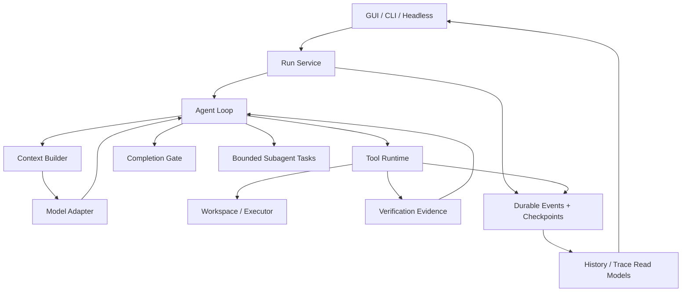

# dcode 系統級升級：研究結論、架構缺口與漸進重構計畫

## 1. 目標與已確認的方向

將 dcode 發展為可供日常使用的本機 Coding Agent，優先處理既有 repository 的 bug fix、跨檔案功能、重構與回歸驗證。

已確認的約束：

- 保留 Go、既有 thread 歷史、設定與主要 GUI／CLI 工作流；內部介面可以調整。
- 本機執行優先，提供隔離環境選項。
- 保留與 Cursor 共用工作目錄的體驗，加入過期寫入與衝突保護；獨立並行修改使用 worktree。
- 本階段只分析既有 benchmark，不啟動新的付費模型評測。
- 重構以失敗案例與驗收結果驅動，每階段可獨立測試及回退。

**建議的主軸：保留簡單的 model／tool loop，優先補齊執行正確性、驗證證據、狀態恢復與資料讀取邊界。** Repo map、LSP、多 agent、模型路由等能力，分別以實驗決定是否進入預設流程。

本輪已完成主要執行路徑的初步原始碼 audit、官方資料與部分開源實作比較；尚未完成所有模組的完整安全審查或新的效果評測。沒有修改專案程式碼。

---

## 2. 業界研究：值得採用的模式

以下將「公開實作／官方行為」與「對 dcode 的建議」分開。閉源產品的文件不能用來推定其內部 graph、prompt 或演算法。

| 系統 | 可核實的設計 | 對 dcode 的啟示 |
|---|---|---|
| **Codex** | 公開 agent loop 說明涵蓋模型與工具反覆交互、prompt prefix caching、compaction；工具 runtime 依工具是否支援並行，選擇共享或排他執行。[Loop](https://openai.com/index/unrolling-the-codex-agent-loop/)、[並行實作](https://github.com/openai/codex/blob/main/codex-rs/core/src/tools/parallel.rs) | 保留簡單 loop；工具並行必須有明確能力宣告與協調。動態內容的位置需要考慮 cache。 |
| **Claude Code** | 官方描述為蒐集 context、採取行動、驗證結果的循環；不同介面共用核心 loop。會保存對話，也會保存修改前的檔案快照。[官方說明](https://code.claude.com/docs/en/how-claude-code-works) | GUI 與 headless 應共用驗證規則；對話恢復與檔案恢復需要分別設計。 |
| **OpenHands SDK** | Agent 操作 Conversation 狀態；事件可序列化並持久化。程式碼另有辨識尚未配對 observation 的 action 邏輯。[架構](https://docs.openhands.dev/sdk/arch/sdk)、[狀態實作](https://github.com/OpenHands/software-agent-sdk/blob/main/openhands-sdk/openhands/sdk/conversation/state.py) | 分離 run 狀態、模型 context 與 UI 讀取資料；恢復時必須處理未完成 action。 |
| **mini-SWE-agent** | v2 預設原生 tool calling；核心仍是精簡的 query／execute loop，提供步數、成本、時間及重複格式錯誤限制。[v2 文件](https://mini-swe-agent.com/latest/advanced/v2_migration/)、[核心實作](https://github.com/SWE-agent/mini-swe-agent/blob/main/src/minisweagent/agents/default.py) | 作為簡單 harness 的對照組；增加 orchestration 必須證明收益。 |
| **SWE-agent** | 研究展示工具介面與觀察格式會影響效能，例如搜尋摘要、檔案閱讀與編輯回饋。[論文](https://arxiv.org/abs/2405.15793) | Tool schema、錯誤回饋及輸出品質應列入評測；早期研究結果不能直接視為目前所有模型的最佳設定。 |
| **Aider** | Repo map 提供符號與定義摘要；實作以圖排序及 token budget 選取內容。[文件](https://aider.chat/docs/repomap.html)、[實作](https://github.com/Aider-AI/aider/blob/main/aider/repomap.py) | 適合評估定位成本高的任務；先比較搜尋加符號資訊的收益，再決定是否預設注入。 |
| **Cursor** | 官方公開長工具輸出保存、歷史按需回讀、skills 與 MCP 工具的動態探索；也使用 semantic search。[動態 context](https://cursor.com/blog/dynamic-context-discovery)、[Semantic search](https://cursor.com/blog/semsearch) | 先提供可找回的原文與按需讀取；向量索引屬於後續需評測的選項。 |
| **Continue** | Context selection 可納入檔案內容、language server 定義、imports 與近期檔案資訊。[官方文件](https://docs.continue.dev/ide-extensions/agent/context-selection) | LSP 可補足符號與關聯查詢，但應容許沒有 language server 的環境正常工作。 |
| **Cline／Roo Code** | 提供 task 管理與 checkpoint；Roo 文件明確區分 workspace 快照及對話恢復，也列出外部修改與還原限制。[Cline](https://docs.cline.bot/core-workflows/task-management)、[Roo](https://roocodeinc.github.io/Roo-Code/features/checkpoints/) | 與 Cursor 共用目錄時，整個 workspace 回滾可能覆蓋其他人的修改；需要以本次修改為邊界。 |
| **Goose** | 權限模式搭配工具層級允許、詢問、禁止；文件也說明讀寫判斷有 best-effort 性質。[權限模式](https://goose-docs.ai/docs/guides/goose-permissions/)、[工具權限](https://goose-docs.ai/docs/guides/managing-tools/tool-permissions/) | Approval、工具分類與作業系統隔離應分開建模。 |
| **Cody** | 公開的 context 機制結合搜尋、code graph 與主動 context fetching。[Context](https://7.3.sourcegraph.com/cody/core-concepts/context)、[Agentic fetching](https://7.3.sourcegraph.com/cody/capabilities/agentic-context-fetching) | 定位能力需要多種可組合訊號，不能只用單一搜尋排名代表全部相關性。 |
| **Copilot Agent** | 公開文件描述隔離執行、驗證與安全控制；firewall 文件明列 MCP、setup process 等涵蓋限制。[應用說明](https://docs.github.com/en/copilot/responsible-use/agents)、[Firewall](https://docs.github.com/en/copilot/how-tos/copilot-on-github/customize-copilot/customize-the-firewall) | 每個控制都要記錄真正覆蓋的執行路徑，避免 shell 有限制但外部工具繞過限制。 |

### 三個重要研究結論

1. **目前沒有證據支持先把整個專案改成更複雜的 graph。**  
   dcode 現有五個節點足以表達基本執行流程。Planning、驗證與恢復需要明確狀態，但未必需要獨立 agent 或額外模型呼叫。

2. **Context 壓縮應先比較不需模型的策略。**  
   Observation masking 研究在其測試範圍內，取得與 LLM summarization 相近的解題率並降低成本。這支持先測試舊輸出替換為可回讀引用，再決定增加摘要模型呼叫。[研究](https://arxiv.org/abs/2508.21433)

3. **Benchmark 必須符合產品用途。**  
   SWE-bench／Pro 可測 repository 修復；RepoBench 主要測 retrieval／completion；CodeClash 測多輪目標導向開發。三者不能互相替代，也無法直接覆蓋 GUI 重連、Cursor 共同修改與 crash recovery。[RepoBench](https://arxiv.org/abs/2306.03091)、[CodeClash](https://docs.codeclash.ai/)

---

## 3. 現況 Audit 與優先級

### 現有架構

```text
GUI／CLI／Headless
        ↓
Service：thread busy map、agent cache、模型選擇
        ↓
CreateCLIAgent → CreateDeepAgent → middleware 組裝
        ↓
before_agent → model → after_model → tools
                  ↑                    │
                  └────────────────────┘
                         ↓
                    after_agent
                         ↓
                  結束或再次呼叫模型

旁路：
PostgreSQL checkpoint／trace／thread／plan
Redis artifacts／cache
子 agent 與背景任務 registry
```

目前 context 由 system prompt、memory、skills、即時專案資訊、歷史與工具定義組成，再經摘要處理。工具批次共享一份 state snapshot 並行執行，結果按呼叫順序套回。

### 值得保留的基礎

- `ChatModel`、`Tool`、`Backend`、checkpoint 已有清楚介面。
- 核心 loop 規模仍可掌握。
- 已有多檔 patch、Go／JS／Python 結構化測試結果。
- 已有模型 retry、串流錯誤处理、context compaction 與原始歷史卸載。
- Trace 已採 blob 去重，並開始分離摘要與詳細內容。
- `dbench` 已有隔離評測、官方 verifier、failure categories、配對比較與信賴區間。

### Gap Analysis

P0 直接影響正確性；P1 影響主要可靠性／效能；P2 為成熟度；P3 為未證明必要的擴充。

| 能力 | 目前實作與問題 | 調整方向 | 優先級 |
|---|---|---|---|
| 完成判定 | VerifyGate 只用於 headless；兩次提醒後可結束，沒有結構化「驗證未完成」狀態 | GUI／CLI 共用 Completion Gate 與 evidence | **P0** |
| 驗證有效性 | 由 transcript、工具名稱及 command regex 判斷；shell 修改不在主要 edit 追蹤中 | 將驗證綁定實際 workspace revision、修改範圍與結果 | **P0** |
| 工具並行 | 最多八個工具一起執行；patch 衝突檢查只涵蓋部分同批次情況 | 明確讀寫能力、資源鎖與依賴順序 | **P0** |
| Cursor 共同修改 | patch 有內容匹配，但缺少一致的版本前置條件；rollback 不檢查所有恢復結果 | 過期寫入拒絕、保守還原、保留衝突 artifact | **P0** |
| Context 邊界 | 有最終請求計算與有限 retry；未知窗口目前為 170k，偏離先前 16k 約定 | 恢復保守 fallback，納入輸出預留及能力測試 | **P0** |
| 工具輸出 | shell 在底層先截斷 100KB；後續卸載無法找回被截掉的部分 | 串流保存 stdout／stderr，context 只放摘要與引用 | **P0** |
| Crash recovery | checkpoint 在 graph step 保存；工具副作用與保存之間存在窗口 | durable tool ledger，明確處理結果未知的執行 | **P0** |
| 執行邊界 | 本機 shell 可訪問 host；`SandboxBackend` 介面名稱不代表有隔離 | 執行環境能力宣告、權限與真正 sandbox 分離 | **P0** |
| GUI 狀態 | 切回 thread 會以歷史重建 view，有覆蓋 live state 的風險；run 仍綁 HTTP request context | 服務擁有 run，GUI 訂閱可重連事件 | **P1** |
| 歷史讀取 | JSONB 分頁仍展開訊息陣列；不足 20 turns 時的 fallback 按訊息數裁切 | 修正 turn 邊界，建立可索引的歷史讀取模型 | **P0／P1** |
| Trace detail | 摘要仍讀整個 thread 的相關 records；diff 展開仍取完整 trace | 依 turn／record 精確查詢 | **P1** |
| 搜尋 | grep 有部分排除規則；glob 與 ignore 行為不一致，沒有統一符號定位 | 統一搜尋範圍，逐級增加 symbol／reference lookup | **P1** |
| Memory | AGENTS 類內容載入一次後存進 thread state | 按來源版本更新、範圍化載入與失效 | **P1** |
| Repair | 主要靠 prompt 與兩次驗證提醒 | failure fingerprint、證據記錄、預算與策略切換 | **P1** |
| Test selection | 可指定 packages／files／filter；没有完整 affected-test 策略 | 先可靠發現測試，再逐級擴大相關範圍 | **P1** |
| Subagents | 有隔離、fork、背景執行與 usage；缺少統一父子預算與寫入契約 | bounded task contract、取消傳播及衝突協調 | **P1** |
| 評測指標 | `TestRuns` 主要辨識 shell 測試命令，漏掉 `run_tests`；gold-file overlap 不等於定位準確度 | 修正量測定義，分開觀察定位、修改與驗證 | **P0** |
| MCP／hooks／sandbox providers | 部分 package 仍只有介面或 `notimpl` | 真正需要才實作，功能清單反映實際可用性 | **P2** |
| 自動 router／全面 semantic index | 尚無本專案增益證據 | 保留為可停用實驗 | **P3** |

主要證據可見 [核心 loop](/Users/tsengmingchun/Documents/open_source/deepagents_golang/agent/loop.go)、[驗證 gate](/Users/tsengmingchun/Documents/open_source/deepagents_golang/code/agent/verify.go)、[patch 寫入與回滾](/Users/tsengmingchun/Documents/open_source/deepagents_golang/code/codetools/applypatch.go)。

### 已執行的檢查

- 八組相關 Go packages 的一般測試通過：agent、runtime、summarization、subagents、code/agent、codetools、server、bench。
- `go test -race`：agent、subagents 通過；server 失敗。
- 已捕捉的 race 是測試修改全域 `shutdownGrace`，與另一個 server goroutine 讀取競爭。這需要修正測試生命週期；目前證據不能用來宣稱產品存在相同的 thread 競爭。
- 本輪沒有執行新的付費 benchmark，也沒有宣稱完成完整瀏覽器 E2E。

---

## 4. 必須納入設計的 Unknown Unknowns

### 4.1 執行完成、資料保存、UI 顯示是不同狀態

工具可能已修改檔案，程序卻在保存結果前 crash。重新執行可能重複副作用；直接略過則可能漏掉工作。

因此必須保存 action 的開始、完成及結果未知狀態。任意 shell／外部 API 無法靠 checkpoint 保證 exactly-once。

### 4.2 驗證證據有有效期限

測試通過後，Cursor 或其他 thread 又改了檔案，之前的結果可能已失效。驗證應記錄被驗證的檔案版本、命令、環境與範圍；修改後重新判定哪些證據仍有效。

### 4.3 過期写入保護不等於能鎖住 Cursor

dcode 可協調自己的 writer，並於寫入前核對內容版本，但 Cursor 不會遵守 dcode 的鎖。共用目錄只能提供保守的衝突檢測；需要強隔離的並行修改必須使用 worktree。

### 4.4 Prompt cache 與即時資訊更新會互相影響

每次更新 system prompt 中間的 branch／status，可能讓後方歷史失去 prefix cache。應保留稳定前綴，將可變 workspace 資訊放在合適的動態區塊，並量測 cache hit。

### 4.5 可重建與不可重建的 artifact 必須區分

目錄列表可以重跑；一次性的失敗日誌、外部回應、寫入前內容未必能重建。後者不能只依賴會過期的 Redis。

### 4.6 低延遲不能只看 token 與工具耗時總和

平行工具耗時相加不等於使用者等待時間。必須分離模型首 token、模型完整回應、工具排隊、執行、DB、context 建構與 GUI 首次呈現，觀察真正的 critical path。

### 4.7 測試過關與需求完成不能合併成一個布林值

原有測試可能沒有覆蓋新需求，也可能本來就失敗。Completion Gate 要保留需求證據、baseline、測試結果及未覆蓋項目；遇到限制時允許結束並呈現未完成狀態，避免無限重試。

### 4.8 Benchmark 本身可能誤導決策

只看 gold patch 檔案重合會懲罰其他正確解法；只看測試呼叫次數會鼓勵無效重跑；排除所有 infra failure 則可能掩蓋產品環境能力不足。這些指標都需要明確定義及原始證據。

---

## 5. Target Architecture

採用單一 Go 程序內的模組化設計。先保留現有 graph driver，將核心狀態與控制規則從 middleware 中整理出來。



### 模組與存在理由

| 模組 | 責任與必要性 |
|---|---|
| **Run Service** | 管理 run 身分、生命週期、取消、核准、steering 與事件訂閱，解除瀏覽器連線和執行生命週期的耦合。 |
| **Agent Loop** | 保留 model → tool → observation 循環，明確決定繼續、等待、驗證、完成或失敗。 |
| **Context Builder** | 統一最終請求的預算、來源、版本、選取、淘汰及壓縮，避免各 middleware 重複改寫。 |
| **Tool Runtime** | 統一 schema validation、權限、並行、timeout、結果保存、錯誤分類與執行紀錄。 |
| **Workspace／Executor** | 統一檔案版本、dirty tree、修改記錄及本機／隔離執行能力。 |
| **Verification Evidence** | 保存檢查範圍、版本與結果；支援修復與完成判定。 |
| **Run Repository** | 保存事件、工具執行紀錄與 checkpoint，提供恢復依據。 |
| **History／Trace Read Models** | 專供 GUI 分頁與 detail 查詢，避免讀取完整 runtime state。 |

### 狀態與介面

新增或整理以下概念，沿用現有介面並以 adapter 漸進接入：

- `RunID`：一次執行；與長期保存的 `ThreadID` 分開。
- `TaskState`：需求、限制、驗收項目、計畫、目前失敗、已完成工作與 pending work。
- `ToolExecution`：call ID、權限、執行狀態、輸入版本、結果引用與副作用類型。
- `VerificationEvidence`：命令、範圍、workspace 版本、exit status、測試數、失敗及完整輸出引用。
- `RunEvent`：具單調序號、schema version、run／thread／parent 關聯的持久事件。
- `ArtifactRef`：區分 durable evidence 與可過期 cache。

核心流程採普通函式與明確狀態；middleware 保留 tracing、通用量測等橫切功能。權限、工具排程、完成判定不再依賴隱含的 middleware 排序。

### 模型與 deterministic code 的分工

- 模型負責需求理解、未知程式碼推理、修復假設及必要的計畫調整。
- 程式負責版本核對、預算、鎖、timeout、事件序號、結果解析、重複失敗計數及狀態轉換。
- Task understanding 與 planning 優先使用既有模型回合及 todo／plan 工具，不預設增加分類模型。
- 小任務直接執行；跨模組或多驗收條件的任務建立明確計畫。
- 修復記錄保存簡短假設、證據與結果，不保存或要求完整 chain-of-thought。

---

## 6. 漸進 Migration Plan

### Phase A：固定現況與建立可信量測

**變更**

- 建立可重現的版本識別：commit、dirty diff 與必要未追蹤檔案的內容雜湊、prompt、設定、模型資訊、工具清單、dataset／image 版本。
- 整理既有 report 與 trace，修正測試次數、usage 完整性及 latency 的計算定義。
- 將 failure taxonomy 分成「直接觀察結果」與「人工判讀根因」；不把推論寫成確定原因。
- 修正 server 測試的全域設定競爭及 cleanup。
- 從已確認問題建立不需付費模型的 regression fixtures。

**驗收與回退**

- 同一批既有 artifacts 可重复產出一致統計。
- 舊資料缺少欄位時標示 unknown，不能補造。
- 新報表保留舊報表與原始資料，量測改動不影響 Agent 行為。

### Phase B：執行與完成正確性

**變更**

- Tool metadata 增加副作用與並行能力；已知唯讀工具可並行，檔案 writer 依路徑協調，任意 shell 預設取得 workspace 排他執行權。
- 檔案修改核對讀取版本；拒絕 stale patch。回滾只在目前內容仍符合本次寫入結果時進行，否則保存差異並回報衝突。
- 原始 stdout／stderr 在截斷前串流保存；context 使用有大小上限的 head／tail、exit status 與引用。保存達上限或失敗必須明示。
- GUI、CLI、headless 共用驗證證據及 Completion Gate。最後一次相關修改之後沒有有效驗證時，不能標示 verified。
- 未知窗口恢復 16k 保守門檻；保留有上限的超窗恢復，檢查固定 prompt、工具定義、保留歷史與輸出預留。
- 修正 prompt 中「修改後停止、不需解釋」等與完成驗證、結果回報衝突的要求。

**驗收與回退**

- 覆蓋同檔並行修改、Cursor 模擬插入修改、rollback 失敗、shell 修改後未驗證、零測試、過期測試結果及超大輸出。
- 新核心能力以設定切換，原工具介面保留 adapter。
- 安全檢查失敗時回報明確限制，不能靜默退回不安全寫入。

### Phase C：Durable Run 與 GUI 資料路徑

**變更**

- 由 service 持有 run context；GUI 關閉只取消訂閱。Stop 明確指定目前 run。
- 新增建立 run、查詢狀態、按事件序號訂閱、cancel、resume／steer 的服務介面；現有 run API 暫留相容 adapter。
- 持久化工具開始與完成紀錄。重啟後未完成的非冪等 action 標記結果未知，先核對副作用，禁止盲目重跑。
- 事件作為新執行的恢復依據；checkpoint 為可重建快照。舊 checkpoint 透過版本化匯入轉接，保留原始資料。
- 歷史讀取改為具穩定 message／turn ID 的索引投影；最新 20 個完整 user turns，synthetic control message 不算新 user turn。
- Cursor 綁定歷史 generation 與邊界；一般新訊息追加不使舊頁失效，歷史改寫才重設。
- Trace 摘要限制在已載入 turn；inspector／diff 依 record ID 取 detail。
- GUI 使用每 thread 的 reducer／session；snapshot 與 live events 按序合併，不能以歷史載入覆蓋較新的串流事件。

**驗收與回退**

- 注入工具前、工具後、checkpoint 前後、串流中斷等 crash。
- 驗證兩個 thread 執行、切換、重新整理、停止其中一個、重複事件與斷線續接。
- 以大型 fixture 檢查 SQL plan、掃描筆數、回應大小及首次內容呈現；不能只量測瀏覽器 rendering。
- 採 additive schema、可重建 projection；舊資料不刪除。回退前停止新 run，將已完成狀態輸出為相容 checkpoint。

### Phase D：Context、定位與驗證策略

**變更**

- 統一搜尋 ignore、結果數、檔案大小與 override 行為。
- 預設路徑為 filename／exact search → 精確讀取 → symbol／reference expansion；大範圍探索才委派。
- 建立 session 級 Environment Profile，由 manifest、CI、scripts 取得執行方式；來源變更時失效。
- Context 保留需求、當前計畫、未解決失敗與有效證據；舊目錄列表、搜尋輸出先替換為引用，再考慮摘要。
- Memory 記錄 scope、來源與內容版本；檔案變更或分支切換後重新核對。
- Test selection 先採語言／專案 adapter：直接相關測試 → 所屬 package／component → 依公共介面或依賴變更擴大。
- 原有失敗與新回歸分開；flaky rerun 保留第一次結果。測試快取先只用於同一 run 且輸入版本與環境完全一致的檢查。
- LSP、repo map、semantic search 分別作為可停用實驗，不一次接入三種索引。

**驗收與回退**

- Go／TS／Python monorepo、generated files、分支切換、規則更新、符號搬移及 stale index。
- 比較首次正確定位所需工具呼叫、讀取量、token 與完成率。
- 無新付費評測期間，僅驗證機制正確性；不宣稱提升 Agent 解題率，也不把實驗能力升為預設。

### Phase E：有界 Repair、Delegation 與隔離成熟度

**變更**

- Repair 記錄 failure fingerprint、假設、證據、patch 理由與驗證；同一版本和同一失敗反覆出現時要求重新探索或改變策略。
- 父子 agent 共用總預算；每個子任務有 goal、範圍、工具權限、輸出要求、停止條件及取消傳播。
- 預設探索子 agent 唯讀；fork 全歷史需明確選擇；共享目錄寫入仍受 Tool Runtime 協調。
- 獨立 reviewer、不同模型 review 與 model routing 只作 A/B 選項。
- 本機執行明確顯示隔離能力。建立 macOS／Linux sandbox adapter 與 Docker 選項，缺少隔離能力時不得宣稱受保護或靜默降級。官方實作可參考 Seatbelt／bubblewrap 的能力與限制。[Sandbox 文件](https://code.claude.com/docs/en/sandboxing)
- 子程序採最小環境變數集合；權限覆蓋檔案、shell、網路與 MCP。Trace／遠端 telemetry 在保存或送出前統一處理敏感資料。
- Web／MCP 資料保留來源、版本與信任層級，工具 schema 按需載入；先整合有真實工作流需求的服務。

**驗收與回退**

- 無進展重試、子任務取消、預算耗盡、重複寫入、跨 workspace 存取、symlink、環境變數與外部工具權限測試。
- 每項新模型呼叫或索引都有獨立開關與量測。
- 無法證明收益的 abstraction／agent／模型呼叫移除，維持原有簡單路徑。

---

## 7. Baseline、驗收與交付標準

### 既有結果的正確解讀

目前找到：

| 結果 | 可使用的資訊 | 限制 |
|---|---|---|
| Stage 12 同題 A/B | 兩側均為 **8/10**，沒有觀察到 resolve rate 增加 | 每題一次、樣本小，報表未記錄完整程式版本 |
| 最新 Stage 17 | **4/5**；其中一次 timeout | 只有 JS／Python，使用 dirty working tree |
| 較早測試 | **0/1**，報表記錄程序遭終止 | 只能作为失敗個案 |

這些屬於**歷史參考結果**，不能直接當作目前工作樹的可重現 baseline。後續先重建能確認的 metadata，無法還原的部分明確標示。

### 評測分三層

1. **Deterministic regression**  
   不需模型費用。覆蓋寫入衝突、輸出保存、超窗、狀態恢復、權限、分頁及多 thread。

2. **既有 trajectory 分析**  
   重算成本、耗時、測試與定位指標，整理有證據的失敗案例；不把 trace replay 當作模型效果評測。

3. **新的 Agent A/B**  
   待另定預算後執行。固定任務、版本、模型設定、環境與預算；主張成功率改善前必須有新評測。以 Go／TS／Python 修復、跨檔案功能與重構分層，另保留不參與調參的 holdout。

### 每階段共同驗收

- 相關單元／整合測試、必要的 race 測試、Go test／vet。
- GUI 變更通過 typecheck、Vitest、build 與瀏覽器 E2E。
- 零遺失既有歷史、零靜默覆蓋已偵測的外部修改、零已完成非冪等 action 的盲目重播。
- 完成畫面顯示實際修改、驗證範圍、結果與未完成項目。
- 效能改動附分段耗時、資料大小及查詢證據；模型策略改動附同條件效果比較。
- 每一新增模組記錄：解決的 failure、驗收方式、成本與停用方法。

**執行順序：先可信量測，再 P0 正確性，接著 durable run／GUI 讀取路徑，最後才擴充定位、委派與模型策略。** 這個順序能保留已有能力，同時讓後續每一次架構升級都有可核對的收益。
